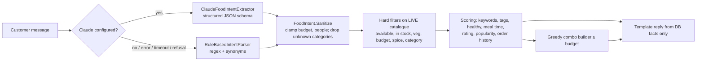

# BiteBot: AI food recommendations

## What it does
Customers type requests like *"Suggest a spicy meal under ₹250"*, *"vegetarian food for two"*, *"something healthy"* or *"similar to my last order"*. BiteBot replies with:
- up to 4 real dishes, each with a reason ("nicely spicy, rated 4.7★")
- a **combo** that fits the budget and party size, when a budget or people count is given
- chips showing how it understood the request, so the user can see why the results appear
- follow-up suggestions

The user adds dishes to the cart. **BiteBot never places orders or takes payments.**

## Architecture: "the LLM parses, the database decides"



Files:
- `Application/Features/AI/FoodIntent.cs`: the `FoodIntent` model, the `IFoodIntentExtractor` port and the rule-based parser
- `Application/Features/AI/BiteBotService.cs`: filtering, scoring, combo and reply
- `Infrastructure/AI/ClaudeFoodIntentExtractor.cs`: the Claude adapter (official `Anthropic` NuGet SDK 13.11)

### Why this design (grounding)
- The model's output is limited to a **strict JSON schema** of filters (budget, people, veg, spice, categories from an enum of real slugs, keywords, meal time, "similar to past orders").
- The model never sees prices, stock or customer data, and never names a dish. All dish names, prices and stock flags come from MySQL at request time, so BiteBot **cannot hallucinate a dish or a price**.
- The output is validated and clamped (`Sanitize`) before use: unknown categories are dropped, values are clamped, and keywords are restricted to letters.
- The customer's message is wrapped in `<message>` tags, and the system prompt tells the model to treat it only as food preferences (prompt-injection hygiene). Even a successful injection could only change *filters*.

### Fallback behaviour
The rule-based parser is used when:
- the provider is `Rules` (the default) or no API key is set,
- Claude times out (15 s, 1 retry) or throws, or
- Claude returns `stop_reason: refusal` or empty output.

Failures are logged without the customer's message text. The API response field `engine` reports `"rules"` or `"claude"`.

Filtering degrades gracefully. If nothing matches, it relaxes the category, then the spice level, and the reply says so ("I widened the search").

### Personalisation
For signed-in users, the last 10 completed orders feed the scoring: matching categories get a small boost. For "similar to my last order", dishes from the same categories rank above the exact same dish.

## Provider and cost

| Option | Cost | Notes |
|---|---|---|
| **Rule-based (default)** | ₹0, offline | Deterministic and unit-tested (`BiteBotParserTests`). Handles common phrasings. |
| **Claude** (`claude-opus-5-5`, effort `low`, structured outputs, server-side refusal fallbacks enabled) | Pay-per-token API. About a few hundred input and output tokens per request. | Needs an Anthropic API key. **A Claude Pro subscription does not include API credits.** |
| Other providers (Gemini, OpenAI, local Ollama) | varies | Add another `IFoodIntentExtractor` adapter; nothing else changes |

Enable Claude:

```bash
dotnet user-secrets set "ANTHROPIC_API_KEY" "<key>" --project backend/src/BiteBox.API
dotnet user-secrets set "BiteBox:AI:Provider" "Claude" --project backend/src/BiteBox.API
```

> **Verification status:** the Claude adapter compiles against the SDK, but it has **not** been run against the live API, because no API key was available. The rule-based path is covered by unit and integration tests.

## Safety and privacy
- The API key lives only on the server (user-secrets or environment variables), never in Angular.
- Only the message text and the list of category slugs are sent to the provider. No names, addresses or order data are sent.
- Rate limit: 15 requests per minute per user or IP. Message length is capped at 300 characters.
- BiteBot has no tools that change state. Adding to the cart is always a user click.

## Limitations
- The rule-based parser understands English keyword phrasing. It doesn't do spelling correction or Hinglish beyond the listed synonyms.
- The combo builder is greedy (fast and explainable), not optimal knapsack.
- Allergen information is not modelled. The UI shows a disclaimer.
