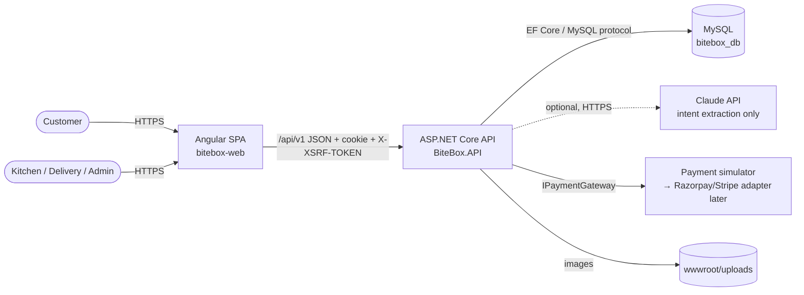
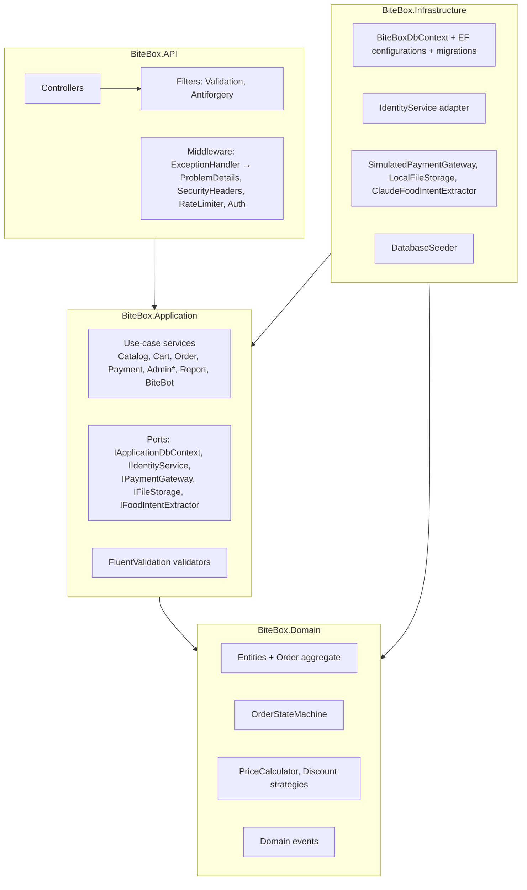
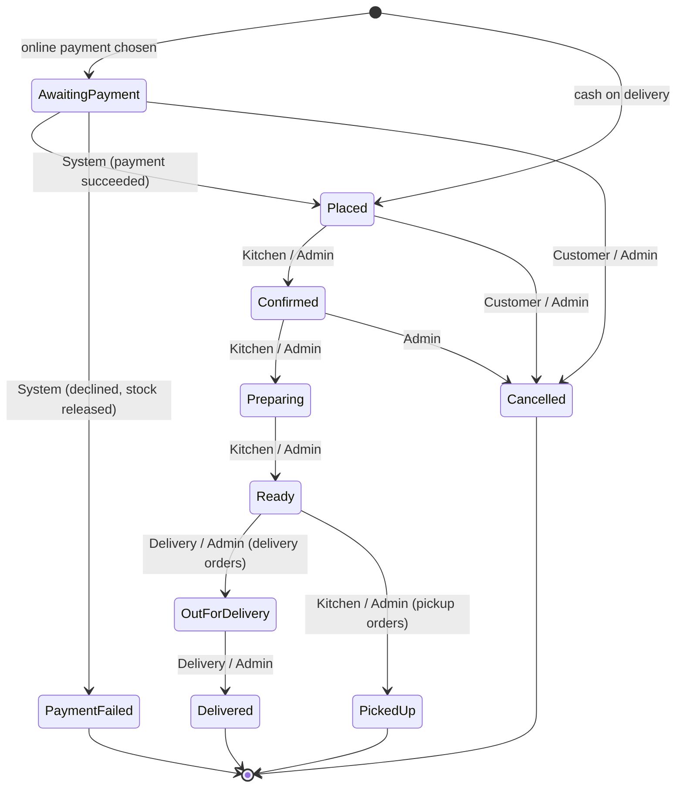
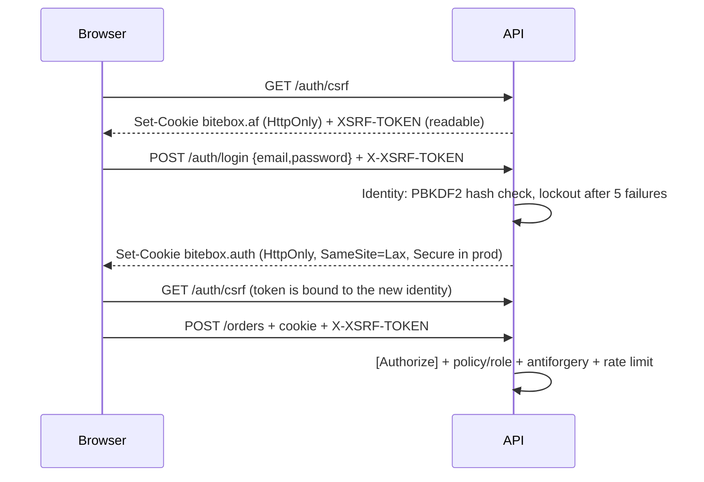
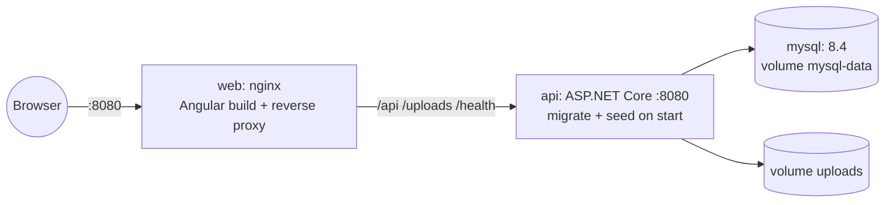

# BiteBox Architecture

## 1. Requirements decisions

The project brief asked for a requirements interview. The owner then asked for the build to go ahead on the recommended defaults below. **Each one can be changed later** without redesigning the system.

| Area | Decision | Why |
|---|---|---|
| Business model | **Single restaurant, one kitchen (Bengaluru)** | A complete order → kitchen → delivery workflow without the cost of vendor onboarding and settlement. A marketplace is listed under future enhancements. |
| Catalogue | Prepared food, desserts, beverages (10 categories, 45 dishes) | Realistic Indian quick-service menu |
| Accounts | Browsing is public. Checkout needs an account. The guest cart is merged on sign-in. | Enables order history, reviews and personalised BiteBot without losing guest carts |
| Fulfilment | Home delivery (₹40, free ≥ ₹499) and pickup | Shows the Strategy pattern for fees |
| Delivery | Restaurant-managed, with a **Delivery** role and status-based tracking | Live GPS would add cost with no demo value |
| Payment | Cash on delivery plus a **simulated** online gateway behind an adapter | No real money. Razorpay/Stripe test mode plugs into the same interface. |
| Roles | Customer, Kitchen, Delivery, Admin | Super Admin and Restaurant Manager would duplicate Admin in a single-restaurant model |
| AI | BiteBot recommendations. Rule-based by default, optional Claude intent extraction. | Works at ₹0. The paid API is opt-in. |
| Hosting | Local (`dotnet run` + `ng serve`) or Docker Compose | Matches a college demo |

**Functional requirements (summary)**
- FR1: browse and search the menu
- FR2: cart
- FR3: checkout with server pricing and coupons
- FR4: online and COD payment
- FR5: order tracking
- FR6: cancellation rules
- FR7: reviews by verified buyers
- FR8: favourites and addresses
- FR9: notifications
- FR10: staff order workflow by role
- FR11: catalogue and inventory management
- FR12: promotions
- FR13: dashboard and reports
- FR14: user and staff management
- FR15: AI recommendations

**Non-functional requirements**
- **Security:** OWASP basics, server-side authorisation, CSRF protection, no secrets in the repo
- **Integrity:** no overselling, idempotent checkout, transactional order creation
- **Performance:** indexed queries, paginated lists, lazy-loaded SPA (~109 kB initial transfer)
- **Maintainability:** Clean Architecture, tests, documentation
- **Accessibility:** keyboard focus, ARIA labels, reduced-motion support
- **Responsive:** mobile to desktop

## 2. System context



## 3. Backend: Clean Architecture (modular monolith)



**Dependency rule:** Domain depends on nothing. Application depends on Domain and uses EF Core abstractions only, never MySQL. Infrastructure implements Application's interfaces. API wires everything together through dependency injection.

| Spring Boot idea | BiteBox equivalent |
|---|---|
| `@RestController` | `ControllerBase` classes in `BiteBox.API/Controllers` |
| `@Service` | `CatalogService`, `OrderService`, … in Application, registered in `AddApplication()` |
| `JpaRepository` | `DbSet<T>` exposed through `IApplicationDbContext` |
| `@Transactional` | `IApplicationDbContext.InTransactionAsync(...)` |
| `@ControllerAdvice` | `GlobalExceptionHandler` (`IExceptionHandler`) |
| Spring Security filter chain | ASP.NET middleware pipeline in `Program.cs` |
| Bean Validation | FluentValidation + `ValidationFilter` |
| `application.yml` profiles | `appsettings.{Environment}.json` + user-secrets + environment variables |

## 4. Request flow: placing an order

```mermaid
sequenceDiagram
  participant A as Angular (CheckoutPage)
  participant I as HttpClient + XSRF + interceptor
  participant C as OrdersController
  participant V as ValidationFilter
  participant S as OrderService
  participant D as Order (Domain)
  participant DB as MySQL

  A->>I: place({fulfilment, addressId, payment, coupon, idempotencyKey})
  I->>C: POST /api/v1/orders  (cookie + X-XSRF-TOKEN)
  Note over C: Auth cookie → ClaimsPrincipal<br/>Antiforgery validated, rate limit checked
  C->>V: PlaceOrderRequestValidator
  V->>S: PlaceOrderAsync
  S->>DB: existing order with this idempotency key?
  S->>DB: load cart with CURRENT prices, address, coupon
  S->>D: PriceCalculator + Coupon.CalculateDiscountFor
  S->>DB: BEGIN
  loop each line
    S->>DB: UPDATE products SET stock = stock - q WHERE id=? AND stock >= q
    DB-->>S: rows affected (0 → 409 Conflict, ROLLBACK)
  end
  S->>D: Order.Create(...) raises OrderPlacedEvent
  S->>DB: INSERT order, items, payment, history, inventory_transactions; DELETE cart
  Note over S,DB: SaveChanges dispatches OrderPlacedEvent → notification
  S->>DB: COMMIT
  C-->>A: 201 Created + OrderDetailDto
```

## 5. Order state machine



The table lives in `BiteBox.Domain/Orders/OrderStateMachine.cs`. The API returns `allowedNextStatuses` for the current user, and the admin UI turns that list directly into buttons.

Side effects:
- **Cancel:** stock is returned, the coupon use is freed, and a paid order moves to `RefundPending`.
- **Delivered / PickedUp:** a COD payment is marked `Paid`.

## 6. Database (MySQL): ER diagram

```mermaid
erDiagram
  users ||--o{ user_roles : has
  roles ||--o{ user_roles : grants
  users ||--o{ addresses : saves
  users ||--o{ cart_items : has
  users ||--o{ favorites : likes
  users ||--o{ reviews : writes
  users ||--o{ notifications : receives
  users ||--o{ orders : places
  categories ||--o{ products : contains
  products ||--o{ cart_items : "in"
  products ||--o{ favorites : "in"
  products ||--o{ reviews : "about"
  products ||--o{ order_items : "snapshot of"
  products ||--o{ inventory_transactions : "moves"
  coupons |o--o{ orders : "applied to"
  orders ||--|{ order_items : contains
  orders ||--|| payments : "paid by"
  orders ||--|{ order_status_history : "audited by"

  products { int Id PK; int CategoryId FK; varchar Slug UK; decimal Price; int StockQuantity; int LowStockThreshold; bool IsAvailable; bool IsDeleted; decimal AverageRating }
  orders { int Id PK; varchar OrderNumber UK; int CustomerId FK; varchar Status; varchar FulfillmentType; decimal Subtotal; decimal DiscountAmount; decimal DeliveryFee; decimal TaxAmount; decimal Total; varchar IdempotencyKey; datetime PlacedAt; varchar DeliveryAddress_Line1 }
  order_items { int Id PK; int OrderId FK; int ProductId FK; varchar ProductName; decimal UnitPrice; int Quantity; decimal LineTotal }
  payments { int Id PK; int OrderId FK; varchar Method; varchar Status; decimal Amount; varchar ProviderReference }
  coupons { int Id PK; varchar Code UK; varchar DiscountType; decimal Value; decimal MaxDiscountAmount; decimal MinOrderAmount; int UsageLimit; int UsedCount }
  inventory_transactions { int Id PK; int ProductId FK; int QuantityChange; int StockAfter; varchar Reason; int OrderId }
```

**Key design decisions**
- **Money** is `DECIMAL(10,2)` everywhere (an EF convention), never float.
- **Enums** are stored as strings (`'OutForDelivery'`) so the data is readable in Workbench.
- **Snapshots:** `order_items` copy the product name and price, and orders copy the delivery address (an EF owned type, `DeliveryAddress_*` columns). Later menu or address edits never rewrite history.
- **Constraints:**
  - unique: `products.Slug`, `orders.OrderNumber`, `coupons.Code`, `(orders.CustomerId, IdempotencyKey)`, `(cart_items.UserId, ProductId)`, `(reviews.ProductId, UserId)`
  - composite primary key: `favorites (UserId, ProductId)`
  - CHECK: `StockQuantity >= 0`, `Price > 0`, `Rating BETWEEN 1 AND 5`, `Quantity BETWEEN 1 AND 20`, `UsedCount >= 0`
- **Indexes** match the hot queries: menu `(CategoryId, IsDeleted, IsAvailable)`, `Price`; kitchen queue `(Status, PlacedAt)`; history `(CustomerId, PlacedAt)`; notifications `(UserId, IsRead, CreatedAt)`; inventory `(ProductId, CreatedAt)`.
- **Soft delete for products:** `order_items → products` is `RESTRICT`, so a dish that was ever ordered can never be physically deleted.
- **Normalisation:** 3NF. The two deliberate denormalisations are snapshots (for history) and `products.AverageRating/ReviewCount` (to avoid aggregating reviews on every menu query). Both are documented in code.
- **Audit:** `CreatedAt` and `UpdatedAt` are stamped in `SaveChangesAsync`. `order_status_history` and `inventory_transactions` are append-only logs.
- **Migrations:** `backend/src/BiteBox.Infrastructure/Persistence/Migrations`, applied on startup when `BiteBox:Database:MigrateOnStartup=true` (Development and Docker). For production, generate a reviewed SQL script with `dotnet ef migrations script --idempotent`.

### Concurrency
- **Overselling:** each order line runs `UPDATE … SET stock = stock - q WHERE id = ? AND stock >= q` inside a transaction. InnoDB row-locks the product row, so of two buyers racing for the last portion, exactly one gets "1 row affected". The other gets 0 → `409 Conflict` → rollback. This is proven by the integration test `Concurrent_orders_for_the_last_portion_never_oversell`.
- **Admin edits vs orders:** stock has no setter. Restock and wastage are relative atomic updates (`stock + delta WHERE stock + delta >= 0`), so an admin can never overwrite a concurrent decrement.
- **Coupons:** `UsedCount = UsedCount + 1 WHERE UsedCount < UsageLimit`, atomic in the same way.
- **Duplicate submissions:** a client idempotency key per checkout visit, with a unique index as the last line of defence (the losing insert re-reads and returns the winner).

## 7. Authentication and authorisation



- **Why cookies, not JWT in localStorage?** An HttpOnly cookie cannot be read by injected JavaScript, so XSS can't steal the session. The cost is CSRF exposure, which is handled by the anti-forgery token (double-submit, validated by the global `AntiforgeryValidationFilter`) and `SameSite`.
- **Policies:** `AdminOnly` and `StaffOnly`. Fine-grained per-transition rules live in the domain state machine, not in controllers.
- **Session invalidation:** blocking a user or changing their role rotates the security stamp, and cookies are re-validated every minute.
- **Other measures:**
  - rate limits on auth (10/min/IP), checkout (10/min/user), BiteBot (15/min) and globally (600/min)
  - security headers on every response
  - upload validation by magic bytes, with random file names
  - ProblemDetails errors that never leak stack traces
- **Secrets:** user-secrets in development, environment variables in Docker. Nothing secret is committed. The only committed credential is the demo-seed password in `appsettings.Development.json`, and it is used only in Development.

## 8. Frontend architecture

```text
src/app/
├── core/            api/ (typed clients + models), state/ (AuthStore, CartStore, FavoritesStore, Toasts), http/ (guards, interceptor)
├── shared/          icon set, product card, UI atoms (veg mark, rating, stepper, status badge, inr pipe), address form
├── layout/          storefront shell (header, cart drawer, footer, notifications), brand/logo, toasts
└── features/        storefront, menu, checkout, auth, account, ai-assistant (BiteBot), admin (dashboard, orders, catalogue, business)
```

- **State:** Angular **signals** in small root stores, with no NgRx (the app's complexity doesn't justify it). RxJS is used where streams matter: debounced search, polling, route parameters.
- **Zoneless change detection** with OnPush components throughout.
- **Lazy loading:** every page is its own chunk, and the admin area never downloads for customers.
- **Security in the SPA:** Angular's built-in XSRF support, an interceptor that refreshes a stale CSRF token once and handles 401s, guards for UX only, open-redirect protection on `returnUrl`, and demo hints shown in dev builds only.
- **URL as state:** menu filters are query parameters, so they can be shared and the back button works.

## 9. Deployment



The same-origin proxy means no CORS configuration and first-party cookies. Health endpoints: `/health/live` (process) and `/health/ready` (database reachable). CI runs on GitHub Actions: backend tests against a MySQL service container, then the frontend tests and production build.
