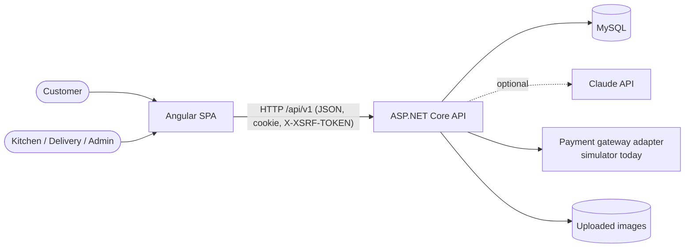
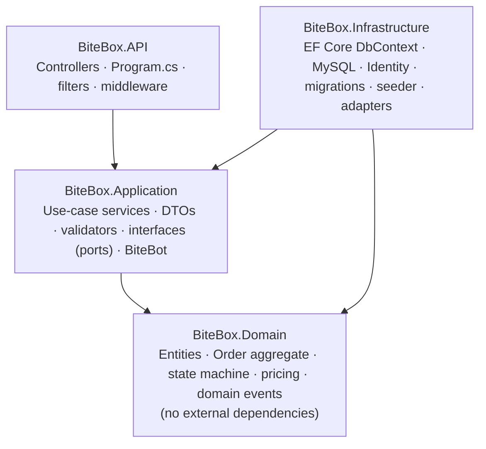
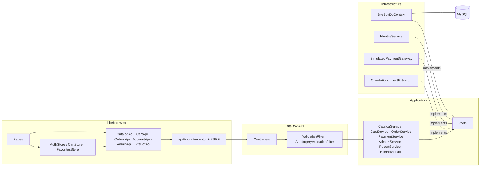
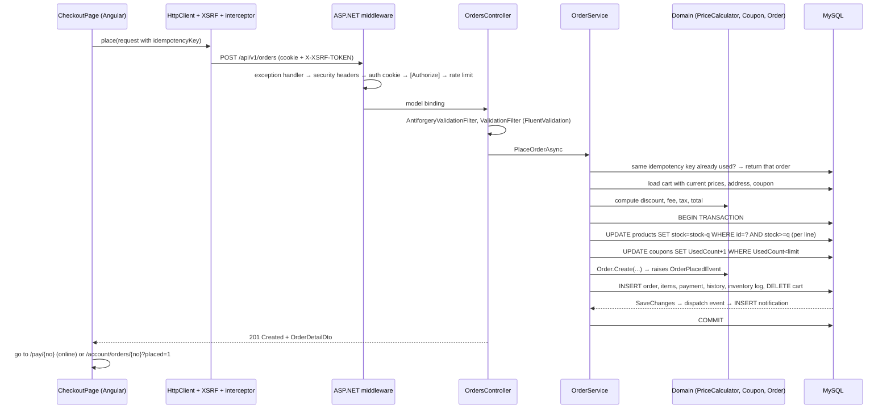
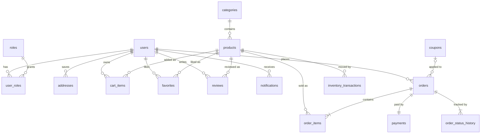
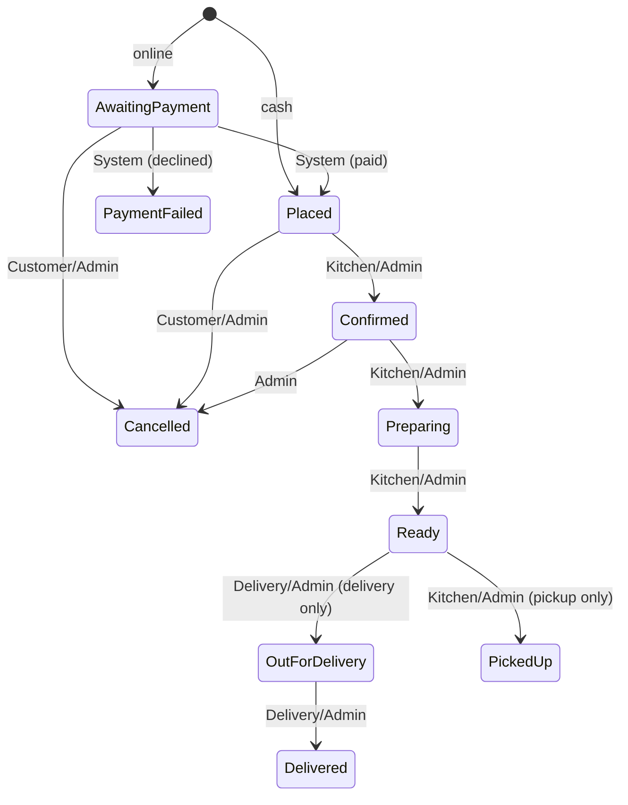
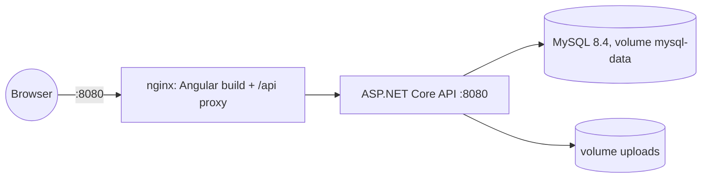

# BiteBox: Software Requirements Specification & System Design Document

**Product:** BiteBox, an AI-powered online food ordering and restaurant management system
**Tagline:** *Every Bite, Anytime.*
**Document type:** SRS (structured after IEEE 830 / ISO/IEC/IEEE 29148) plus design, code and database guide
**Version:** 1.0 · 20 November 2026
**Repository root:** `D:\BiteBox`

> **How to read this document.**
> - Sections 1–5 are the classic SRS: *what* the system must do.
> - Sections 6–10 explain *how* it is built: architecture, backend code, frontend code, database, key algorithms.
> - Sections 11–14 cover security, testing, deployment and traceability.
> - The appendices hold a glossary, configuration keys and a file index.
>
> If you read it top to bottom you should be able to explain any part of BiteBox in a viva or interview.

---

## Table of contents

1. [Introduction](#1-introduction)
2. [Overall description](#2-overall-description)
3. [Functional requirements (system features)](#3-functional-requirements-system-features)
4. [External interface requirements](#4-external-interface-requirements)
5. [Non-functional requirements](#5-non-functional-requirements)
6. [System architecture](#6-system-architecture)
7. [Backend design & code walkthrough](#7-backend-design--code-walkthrough)
8. [Frontend design & code walkthrough](#8-frontend-design--code-walkthrough)
9. [Database design](#9-database-design)
10. [Key algorithms & business rules](#10-key-algorithms--business-rules)
11. [Security design](#11-security-design)
12. [Testing](#12-testing)
13. [Deployment & operations](#13-deployment--operations)
14. [Requirements traceability matrix](#14-requirements-traceability-matrix)
15. [Appendices](#15-appendices)

---

## 1. Introduction

### 1.1 Purpose
This document specifies the requirements of **BiteBox** and describes its design and implementation, so that:
- evaluators can check the system against its stated requirements;
- a developer can understand, run, maintain and extend the code;
- the author can explain every design decision in a viva or technical interview.

### 1.2 Scope
BiteBox is a web application for **one restaurant** (one kitchen in Bengaluru) that serves three groups:

| Part | Users | Purpose |
|---|---|---|
| **BiteBox storefront** | Guests, customers | Browse the menu, get AI suggestions, order food for delivery or pickup, pay, track orders, review dishes |
| **BiteBox Admin** | Admin, kitchen staff, delivery staff | Run the order queue, manage the menu, stock, promotions and users, view analytics |
| **BiteBox API** | Both of the above (through the Angular app) | Enforces every business and security rule and stores data in MySQL |

**In scope:**
- **Ordering:** accounts, menu and search, cart, checkout, coupons, cash-on-delivery and *simulated* online payment
- **Fulfilment:** order lifecycle and live tracking, cancellation and refunds, in-app notifications
- **Customer features:** reviews, favourites, saved addresses
- **Back office:** inventory with audit trail, analytics dashboard, CSV reports, user and staff management, image upload
- **Extras:** the BiteBot AI assistant, Docker deployment files, automated tests

**Out of scope (future work):** multiple restaurants or branches, real money collection, GPS rider tracking, SMS/email/push notifications, a native mobile app, loyalty points, product variants and add-ons.

### 1.3 Definitions, acronyms and abbreviations

| Term | Meaning |
|---|---|
| SPA | Single-Page Application (the Angular frontend) |
| API | Application Programming Interface: the REST endpoints under `/api/v1` |
| DTO | Data Transfer Object: a C# record that defines the JSON shape of a request or response |
| EF Core | Entity Framework Core, the .NET ORM (object–relational mapper; similar to Hibernate/JPA) |
| CSRF / XSRF | Cross-Site Request Forgery, and the anti-forgery token that prevents it |
| COD | Cash on delivery |
| GST | Goods and Services Tax (5% on restaurant food in this system) |
| Slug | URL-friendly identifier, e.g. `masala-dosa` |
| Idempotency key | Random ID sent with a checkout so repeated clicks create only one order |
| Aggregate | A domain object that guards its own rules (e.g. `Order` with its items, payment and history) |
| Soft delete | Marking a row as deleted (`IsDeleted = true`) instead of physically removing it |
| BiteBot | BiteBox's AI food-recommendation assistant |
| Intent | BiteBot's structured reading of a message (budget, people, veg, spice, …) |

### 1.4 References
- IEEE Std 830-1998 / ISO/IEC/IEEE 29148: SRS structure
- Project docs: `README.md`, `docs/ARCHITECTURE.md`, `docs/API.md`, `docs/DESIGN-PATTERNS.md`, `docs/AI-BITEBOT.md`, `docs/DESIGN-SYSTEM.md`, `docs/TESTING.md`, `docs/PRESENTATION.md`, `docs/VIVA-QUESTIONS.md`
- Documentation for Angular 22, ASP.NET Core 9, EF Core 9, MySQL 8 and OWASP ASVS (security)

### 1.5 Technology summary

| Layer | Technology & version | Why it was chosen |
|---|---|---|
| Frontend | **Angular 22.1**, TypeScript 6, SCSS, RxJS 7.8, Vitest 4 | Standalone components, signals, zoneless change detection, strong typing |
| Backend | **ASP.NET Core 9** Web API, C# 13 | Mature, fast, built-in DI, Identity, rate limiting, ProblemDetails |
| ORM | **EF Core 9.0.23** + **MySql.EntityFrameworkCore 9.0.20** (Oracle's official provider) | Code-first migrations; the official provider has an EF Core 10 line ready for an upgrade |
| Database | **MySQL 8** (8.0.43 locally, 8.4 in Docker) | Free, relational, ACID transactions, InnoDB row locking |
| Auth | ASP.NET Core Identity + HttpOnly cookie + anti-forgery | Secure password hashing, lockout, no tokens readable by JavaScript |
| Validation | FluentValidation 12 | Readable, testable validation rules |
| API docs | Swashbuckle 9 (Swagger/OpenAPI) | Interactive API explorer |
| AI (optional) | Anthropic C# SDK 13.11 (`claude-opus-5-5`) | Structured JSON outputs; adapter pattern keeps it swappable |
| Tests | xUnit 2.9, Moq 4.20, `Microsoft.AspNetCore.Mvc.Testing`, Vitest | Unit, mock-based and real-database integration tests |
| DevOps | Docker, Docker Compose, nginx, GitHub Actions | Reproducible deployment and CI |

> **Note on .NET version:** the brief preferred .NET 10, but only the .NET 9 SDK was installed and the owner asked not to install anything new. Moving up means changing `TargetFramework` to `net10.0`, updating `global.json`, and bumping the EF Core and MySQL provider packages to 10.x. No code changes are expected.

---

## 2. Overall description

### 2.1 Product perspective
BiteBox is a self-contained system. Its only optional external dependencies are the Anthropic API (BiteBot) and the Unsplash image CDN (demo photos).



### 2.2 Product functions (summary)
1. Menu browsing with search, filters and sorting
2. BiteBot natural-language food recommendations
3. Guest and account carts
4. Checkout with server-side pricing, coupons, delivery or pickup, COD or online payment
5. Order lifecycle with role-based transitions and live tracking
6. Cancellation, stock release and refund tracking
7. Notifications, favourites, addresses, reviews
8. Admin dashboard and reports
9. Menu, category, inventory, promotion and user management

### 2.3 User classes and characteristics

| User class | Description | Permissions |
|---|---|---|
| **Guest** | Not signed in | Browse menu, view dishes and reviews, use BiteBot, build a local cart |
| **Customer** (`Customer` role) | Registered diner | Everything a guest can do, plus checkout, orders, cancel (before confirmation), reviews, favourites, addresses, profile |
| **Kitchen staff** (`Kitchen`) | Cooks / counter | Order queue; Placed → Confirmed → Preparing → Ready; hand over pickup orders |
| **Delivery partner** (`Delivery`) | Rider | Sees only ready or out-for-delivery delivery orders; Ready → OutForDelivery → Delivered |
| **Administrator** (`Admin`) | Owner / manager | Everything: dashboard, all transitions, cancel any order, refunds, menu, stock, promotions, users, reports |

### 2.4 Operating environment
- **Client:** any modern browser (Chrome, Edge, Firefox, Safari); responsive from 360 px phones to desktop.
- **Server:** Windows, Linux or macOS with the .NET 9 runtime, or a Docker container.
- **Database:** MySQL 8.0+ with InnoDB and utf8mb4.
- **Development tools:** .NET SDK 9.0.321, Node 24.19, npm 11.17, Angular CLI 22.1.6.

### 2.5 Design and implementation constraints
- Must use Angular, C# / ASP.NET Core, MySQL and EF Core code-first migrations (from the brief).
- No paid service may be required: AI defaults to a free rule-based engine, and payment is simulated.
- No secrets in source control.
- Single deployable backend (modular monolith, not microservices).

### 2.6 Assumptions and dependencies
- One restaurant, one kitchen, prices in Indian Rupees (₹), 5% GST, restaurant timezone IST (UTC+5:30).
- Delivery fee ₹40, free at ₹499 or above after discount. Minimum order ₹99. All configurable.
- Stock is counted in "portions available today", which the kitchen restocks.
- Demo data is fictional (`example.com` emails).

---

## 3. Functional requirements (system features)

Each requirement has an ID (FR-x.y), a priority (**H**igh / **M**edium / **L**ow), and the place it is implemented. "API" means the server enforces it, so it cannot be bypassed from the browser.

### 3.1 Authentication & accounts (FR-1)

| ID | Requirement | Priority |
|---|---|---|
| FR-1.1 | A guest can register with full name, email, 10-digit Indian mobile number and password. The password needs ≥ 8 characters with an uppercase letter, a lowercase letter and a digit. A new account gets the `Customer` role and is signed in immediately. | H |
| FR-1.2 | A user can sign in with email and password, with an optional "keep me signed in". | H |
| FR-1.3 | After 5 failed sign-ins, the account is locked for 5 minutes. | H |
| FR-1.4 | Sign-in errors never reveal whether an email exists ("Incorrect email or password"). | H |
| FR-1.5 | A user can sign out. | H |
| FR-1.6 | A user can view and update their name and phone, and change their password (current password required). | M |
| FR-1.7 | Blocked (inactive) users cannot sign in, and their existing sessions stop working within about 1 minute. | H |
| FR-1.8 | After sign-in, users are sent to the page they came from (internal URLs only) or to their role's home page. | M |

*Implementation:* `AuthController` → `IdentityService` (ASP.NET Core Identity). Frontend: `LoginPage`, `RegisterPage`, `ProfilePage`, `AuthStore`.

### 3.2 Menu & catalogue (FR-2)

| ID | Requirement | Priority |
|---|---|---|
| FR-2.1 | Anyone can list active categories with their dish counts. | H |
| FR-2.2 | Anyone can list dishes with paging (max 100 per page) and these filters: text search (name, description, tags, category; each word must match), category, veg only, min/max price, max spice level, featured only, in stock only. | H |
| FR-2.3 | Sorting: popularity (portions sold), rating, price low→high, price high→low, newest. | M |
| FR-2.4 | A dish page shows the photo, description, price, veg/non-veg mark, spice level, prep time, servings, calories, tags, rating, and availability ("Sold out", "Only N left" when ≤ 5, "Available"). | H |
| FR-2.5 | A dish page shows up to 4 related dishes from the same category. | L |
| FR-2.6 | Deleted dishes and dishes in hidden categories never appear on the storefront. | H |
| FR-2.7 | Menu filters are stored in the URL, so a filtered view can be bookmarked or shared. | L |

*Implementation:* `CatalogController` → `CatalogService`. Frontend: `Home`, `MenuPage`, `ProductDetailPage`, `ProductCardComponent`.

### 3.3 BiteBot AI assistant (FR-3)

| ID | Requirement | Priority |
|---|---|---|
| FR-3.1 | Anyone can send BiteBot a message of up to 300 characters. | H |
| FR-3.2 | BiteBot understands: budget ("under ₹250"), party size ("for two", "family"), veg / non-veg, spice preference (spicy / very spicy / mild), healthy, meal time, food words and categories, and "similar to my last order". | H |
| FR-3.3 | BiteBot returns up to 4 dishes, each with a reason. **Every dish, price and stock flag comes from the database.** | H |
| FR-3.4 | When a budget or party size is given, BiteBot proposes a combo that fits the budget and feeds the party, and states the food total. | M |
| FR-3.5 | For signed-in customers, BiteBot personalises results using their last 10 completed orders. | M |
| FR-3.6 | If nothing matches, BiteBot relaxes the category, then the spice level, and says so. | M |
| FR-3.7 | BiteBot never adds to the cart, places orders or makes payments. The user decides. | H |
| FR-3.8 | BiteBot works with no paid AI. If Claude is configured but fails, it falls back to the rule-based parser. | H |
| FR-3.9 | BiteBot is limited to 15 requests per minute per user or IP. | M |

*Implementation:* `BiteBotController` → `BiteBotService`, `RuleBasedIntentParser`, `ClaudeFoodIntentExtractor`. Frontend: `BiteBotPanel`.

### 3.4 Cart (FR-4)

| ID | Requirement | Priority |
|---|---|---|
| FR-4.1 | Guests can add, change and remove items in a cart stored in the browser (`localStorage`). | H |
| FR-4.2 | Signed-in users have a server cart, one row per (user, dish). | H |
| FR-4.3 | On sign-in, the guest cart is merged into the server cart. Unavailable dishes are skipped and quantities are capped at stock. | M |
| FR-4.4 | Quantity per dish is 1–20 and can't exceed current stock. Unavailable dishes can't be added. | H |
| FR-4.5 | The cart always shows **current** prices and flags lines that are out of stock. | H |
| FR-4.6 | A mini-cart drawer and a full cart page show the subtotal and progress towards free delivery. | L |

*Implementation:* `CartController` → `CartService`. Frontend: `CartStore`, the drawer in `StoreLayout`, `CartPage`.

### 3.5 Checkout, pricing & coupons (FR-5)

| ID | Requirement | Priority |
|---|---|---|
| FR-5.1 | Checkout needs a signed-in account. | H |
| FR-5.2 | The customer chooses **home delivery** (with a saved or new address) or **pickup**. | H |
| FR-5.3 | The customer chooses **cash on delivery / pay at counter** or **online (simulated)**. | H |
| FR-5.4 | Before ordering, the server returns a quote: item total, discount, delivery fee, GST and total, plus any problems (stock, minimum order). | H |
| FR-5.5 | **The server ignores any price from the client.** It recalculates everything from current database prices. | H |
| FR-5.6 | Coupon rules are enforced: active, inside the validity window, total usage limit, per-customer limit, minimum order. Percentage coupons have an optional cap. Flat coupons never exceed the subtotal. | H |
| FR-5.7 | Delivery fee = ₹40, waived when (subtotal − discount) ≥ ₹499. Pickup is free. GST = 5% of (subtotal − discount). | H |
| FR-5.8 | Minimum order value is ₹99. | M |
| FR-5.9 | Each checkout carries a unique **idempotency key**. Repeating the request returns the original order instead of creating a duplicate. | H |
| FR-5.10 | Stock is reserved atomically when the order is placed. If any line can't be reserved, the whole order is rejected (409) and nothing changes. | H |
| FR-5.11 | The order stores snapshots of dish names, unit prices and the delivery address. | H |
| FR-5.12 | The cart is emptied after a successful order. | M |
| FR-5.13 | Checkout is limited to 10 requests per minute per user. | M |

*Implementation:* `OrdersController` → `OrderService`, `PriceCalculator`, `Coupon`, the fulfilment-fee strategies, `StockLedger`. Frontend: `CheckoutPage`.

### 3.6 Payment (FR-6)

| ID | Requirement | Priority |
|---|---|---|
| FR-6.1 | A COD order starts as **Placed**, with payment *Pending*. Payment becomes *Paid* when the order is Delivered or PickedUp. | H |
| FR-6.2 | An online order starts as **AwaitingPayment**. The customer simulates success or failure on a clearly labelled test page. **No card details are ever collected.** | H |
| FR-6.3 | Success → payment *Paid* (with a gateway reference) and order **Placed**. | H |
| FR-6.4 | Failure → payment *Failed*, order **PaymentFailed**, stock and coupon use released. | H |
| FR-6.5 | Cancelling a paid order sets payment to *RefundPending*. An admin can then record the refund (*Refunded*). | M |

*Implementation:* `PaymentService`, `IPaymentGateway` → `SimulatedPaymentGateway`, `Order.ConfirmOnlinePayment/FailOnlinePayment/MarkRefunded`. Frontend: `PaymentPage`.

### 3.7 Order lifecycle & tracking (FR-7)

| ID | Requirement | Priority |
|---|---|---|
| FR-7.1 | Order statuses: AwaitingPayment, Placed, Confirmed, Preparing, Ready, OutForDelivery, Delivered, PickedUp, Cancelled, PaymentFailed. | H |
| FR-7.2 | Only the transitions in the state machine (§10.3) are allowed, and only by the listed roles. Pickup orders can't go out for delivery. | H |
| FR-7.3 | Every transition is saved in a status history with time, user and optional note. | H |
| FR-7.4 | Customers see their orders (paged) and each order's details, live tracker and history. The page refreshes every 20 s while the order is active. | H |
| FR-7.5 | A customer can cancel only while the order is AwaitingPayment or Placed. Admins can also cancel Confirmed orders, with a required reason. Cancelling releases stock and the coupon use. | H |
| FR-7.6 | A customer can never see another customer's order (the API answers 404). | H |
| FR-7.7 | "Order again" adds the still-available items of a past order back to the cart. | L |

*Implementation:* `Order`, `OrderStateMachine`, `OrderService`, `AdminOrderService`. Frontend: `MyOrdersPage`, `OrderDetailPage`, `OrdersPage` (admin).

### 3.8 Notifications, favourites, addresses, reviews (FR-8)

| ID | Requirement | Priority |
|---|---|---|
| FR-8.1 | The customer gets an in-app notification when an order is placed and on every status change. The bell shows the unread count (checked every 45 s), and opening it marks everything as read. | M |
| FR-8.2 | Customers can favourite and unfavourite dishes and view their favourites. | L |
| FR-8.3 | Customers can create, edit and delete up to 10 addresses. The first one, or a chosen one, is the default. Pincode must be 6 digits and phone 10 digits. | M |
| FR-8.4 | Only a customer who has received a dish (Delivered or PickedUp) can review it, once, with a 1–5 rating and an optional comment of up to 500 characters. The dish's average rating and review count update immediately. Public reviews show the name as "First L.". | M |

### 3.9 Staff order operations (FR-9)

| ID | Requirement | Priority |
|---|---|---|
| FR-9.1 | Staff see a **live queue** (active orders, oldest first, refreshed every 30 s) and an "All" view with filters: status, delivery/pickup, search by order number, name or phone, date range, paging. | H |
| FR-9.2 | Delivery partners only see delivery orders that are Ready, OutForDelivery or Delivered. | H |
| FR-9.3 | The order panel shows the customer, address, kitchen notes, items, total, payment and timeline, plus action buttons for exactly the transitions the user is allowed to make. | H |

### 3.10 Admin: catalogue, inventory, promotions, users, reports (FR-10)

| ID | Requirement | Priority |
|---|---|---|
| FR-10.1 | Create and edit dishes: name, description, category, price (₹1–1,00,000), image URL (https or uploaded), veg, spice, calories, prep time, servings, tags, available, featured, low-stock threshold, opening stock. The slug is generated and kept unique. | H |
| FR-10.2 | Upload a dish photo (JPG/PNG/WEBP, ≤ 2 MB). The server checks the real file signature and stores it under a random name. | M |
| FR-10.3 | Deleting a dish is a **soft delete**: it leaves the menu and carts, but order history and reviews stay intact. | H |
| FR-10.4 | Category CRUD with display order and visibility. A category that still has dishes can't be deleted. | M |
| FR-10.5 | Inventory: list (optionally low-stock only), adjust stock with a reason (Restock, Wastage, Correction) and note, never below zero. **Every stock movement is logged** with the stock level after it. | H |
| FR-10.6 | Coupon CRUD (percentage or flat, cap, minimum, validity window, total and per-user limits, active flag). A coupon that has been used is deactivated rather than deleted. | M |
| FR-10.7 | Users: search and filter by role, see order count and total spent, change role, block or unblock, create staff accounts. Admins can't block or demote themselves. | H |
| FR-10.8 | Dashboard for any date range (default last 30 days, max 366): revenue, average order value, active orders now, completed, cancelled, new customers, revenue per day (chart and table), top 5 dishes, orders by status, low-stock dishes, latest 6 orders. | H |
| FR-10.9 | Reports: sales by day and dish performance, with CSV export. | M |
| FR-10.10 | Revenue counts only orders that were actually placed (excludes AwaitingPayment, PaymentFailed and Cancelled). Days are bucketed in IST. | H |

---

## 4. External interface requirements

### 4.1 User interfaces
- **Storefront:**
  - sticky header (logo, nav, search, notifications bell, cart button, account menu)
  - cart drawer, footer, floating BiteBot launcher
  - pages: Home, Menu, Dish, Cart, Checkout, Payment, Sign in, Register, Account (Orders, Order detail, Favourites, Addresses, Profile), 404
- **BiteBox Admin:** dark sidebar (shows only items the role can use) and pages: Dashboard, Orders, Menu items, Categories, Inventory, Promotions, Customers & staff, Reports.
- **Design system:** coral `#E8572A` brand colour, cream background, charcoal text, *Fraunces* + *Plus Jakarta Sans* fonts, a consistent icon set, and loading, empty and error states on every data view. Details in `docs/DESIGN-SYSTEM.md`.
- **Accessibility:** skip link, visible focus rings, ARIA labels on icon buttons, keyboard-focusable chart points, `prefers-reduced-motion` support, and colour never used as the only signal.

### 4.2 Software interfaces (REST API)
- Base path `/api/v1`, JSON bodies, enums as strings, paging `{items, page, pageSize, totalCount, totalPages}`.
- Errors use **RFC 7807 ProblemDetails** with a stable `code` (e.g. `cart.insufficient_stock`, `csrf_invalid`).
- The full endpoint list is in `docs/API.md` and live at `/swagger`.

| Group | Main endpoints |
|---|---|
| Auth | `GET /auth/csrf`, `POST /auth/register`, `POST /auth/login`, `POST /auth/logout`, `GET/PUT /auth/me`, `POST /auth/me/password` |
| Catalogue | `GET /categories`, `GET /products`, `GET /products/{slug}`, `GET /products/{slug}/related`, `GET/POST /products/{id}/reviews`, `GET /promotions` |
| AI | `POST /ai/bitebot` |
| Cart | `GET /cart`, `POST /cart/items`, `PUT/DELETE /cart/items/{productId}`, `DELETE /cart`, `POST /cart/merge` |
| Orders | `POST /orders/quote`, `POST /orders`, `GET /orders`, `GET /orders/{no}`, `POST /orders/{no}/cancel`, `/reorder`, `/payment` |
| Account | `/account/addresses`, `/account/favorites`, `/account/notifications`, `/account/reviews` |
| Admin | `/admin/dashboard`, `/admin/reports/*`, `/admin/products`, `/admin/categories`, `/admin/inventory`, `/admin/coupons`, `/admin/orders`, `/admin/users` |
| Health | `GET /health/live`, `GET /health/ready` |

### 4.3 Hardware interfaces
None specific. Any machine able to run .NET 9, Node 24 and MySQL 8. About 1 GB of RAM is enough for the demo.

### 4.4 Communication interfaces
- HTTP(S). In development the Angular dev server proxies `/api` and `/uploads` to `http://localhost:5080` (`proxy.conf.json`). In Docker, nginx does the same, so the browser always talks to a **single origin**: no CORS, first-party cookies.
- Optional HTTPS calls from the API to the Anthropic API.

---

## 5. Non-functional requirements

| ID | Category | Requirement | How it is met |
|---|---|---|---|
| NFR-1 | Security | OWASP Top-10 basics; server-side authorisation; CSRF protection; secrets never committed | §11 |
| NFR-2 | Data integrity | No overselling; no duplicate orders; atomic order creation; immutable order history | Conditional `UPDATE`s, idempotency key + unique index, transactions, snapshots (§10) |
| NFR-3 | Performance | Menu and list API responses < 300 ms on the demo dataset; initial SPA download < 150 kB transferred | Indexed queries, `AsNoTracking` projections, paging, lazy-loaded routes (measured: **108.9 kB**) |
| NFR-4 | Availability / resilience | DB transient-failure retries; AI failure never breaks the feature; health endpoints | `EnableRetryOnFailure(3)`, BiteBot fallback, `/health/*` |
| NFR-5 | Usability | Responsive 360 px+; clear feedback (toasts, skeletons, empty and error states); Indian ₹ formatting (₹1,25,000) | Design system, `InrPipe` |
| NFR-6 | Accessibility | Keyboard navigation and screen-reader labels | §4.1 |
| NFR-7 | Maintainability | Layered architecture, SOLID, documented patterns, nullable warnings treated as errors | §6–7, `Directory.Build.props` |
| NFR-8 | Testability | Domain logic testable without I/O; integration tests on the real database | §12 (61 backend + 11 frontend tests) |
| NFR-9 | Portability | Runs on Windows, Linux and macOS, or in Docker | Docker Compose |
| NFR-10 | Abuse prevention | Rate limits: auth 10/min/IP, checkout 10/min, BiteBot 15/min, global 600/min | ASP.NET Core rate limiter |
| NFR-11 | Privacy | Minimal personal data; public reviews show "First L."; the AI provider receives no personal data | §11, §10.6 |
| NFR-12 | Auditability | Order status history and inventory transactions are append-only logs; `CreatedAt/UpdatedAt` on main entities | §9 |

---

## 6. System architecture

### 6.1 Architectural style
- **Modular monolith** using **Clean Architecture** (also called "Onion" or "Ports & Adapters").
- **Why not microservices?** One restaurant, one team, and order placement must update stock, coupons and orders **atomically**. In one database that's a single transaction. Across services it would need sagas.
- **Why Clean Architecture?** Business rules can be tested in milliseconds without a database, and infrastructure (MySQL, payment provider, AI provider) can be replaced without touching them.

### 6.2 Layers and dependency rule



| Layer | Contains | Depends on | Spring Boot analogy |
|---|---|---|---|
| **Domain** | Business entities and rules | nothing | `@Entity` classes with behaviour |
| **Application** | Use cases (services), DTOs, validation, interfaces | Domain (+ EF Core *abstractions* only) | `@Service` layer |
| **Infrastructure** | Database, Identity, external adapters | Application, Domain | `@Repository` + config + clients |
| **API** | HTTP endpoints, pipeline, DI wiring | Application, Infrastructure | `@RestController` + security config |

### 6.3 Component view



### 6.4 Request lifecycle (example: placing an order)



---

## 7. Backend design & code walkthrough

Solution: `backend/BiteBox.sln`. Shared build settings are in `backend/Directory.Build.props` (net9.0, nullable enabled, nullable warnings as errors). `backend/global.json` pins SDK 9.0.x. `backend/nuget.config` uses only nuget.org.

### 7.1 `BiteBox.Domain`: business rules (no dependencies)

| File | What it contains | Key points to explain |
|---|---|---|
| `Common/Entity.cs` | `Entity` base (Id + domain-event list) and `AuditableEntity` (CreatedAt, UpdatedAt) | Entities collect events with `Raise()`; the DbContext dispatches them after saving |
| `Common/IDomainEvent.cs` | Marker interface | Observer pattern |
| `Common/Money.cs` | `Money.Round()`: 2 decimals, midpoint away from zero | One rounding rule for the whole app |
| `Enums/Enums.cs` | `OrderStatus`, `FulfillmentType`, `PaymentMethod`, `PaymentStatus`, `SpiceLevel`, `DiscountType`, `InventoryReason`, `OrderActor` | Stored as strings in MySQL |
| `Entities/Product.cs` | Dish entity | `SetPrice` validates (0 < price ≤ ₹1,00,000); `StockQuantity` has **no public setter** (only atomic SQL changes it); `CanBeOrdered` = available ∧ ¬deleted ∧ stock > 0; `SoftDelete()` |
| `Entities/Category.cs` | Category | Slug, display order, visibility |
| `Entities/Customer.cs` | `Address`, `CartItem` (max 20/item), `Favorite`, `Review` (`SetRating` 1–5), `Notification`, `InventoryTransaction` | Simple entities grouped in one file |
| `Entities/Coupon.cs` | Coupon + `CalculateDiscountFor(subtotal, now, timesUsedByUser)` | Throws `DomainException` with codes such as `coupon.expired`, `coupon.min_order`; uses `DiscountStrategyFactory` |
| `Entities/Order.cs` | **Order aggregate**: `Order`, `OrderItem`, `OrderStatusChange`, `Payment`, `DeliveryAddress` value object | `Order.Create(...)` factory guarantees a valid order; `ChangeStatus()` checks the state machine, writes history and raises events; payment methods `ConfirmOnlinePayment`, `FailOnlinePayment`, `MarkRefunded`; all setters private |
| `Orders/OrderStateMachine.cs` | Table of legal transitions `(From, To, Actors, OnlyFor fulfilment)` | `CanTransition`, `NextStatuses`, `IsTerminal`, `ActiveStatuses` |
| `Pricing/DiscountStrategies.cs` | `IDiscountStrategy`, `PercentageDiscountStrategy`, `FlatDiscountStrategy`, `DiscountStrategyFactory` | Strategy + Factory patterns |
| `Pricing/PriceBreakdown.cs` | `PriceLine`, `PriceBreakdown`, `PriceCalculator.Calculate()` | **Single source of truth** for totals, used by both quote and order placement |
| `Events/OrderEvents.cs` | `OrderPlacedEvent`, `OrderStatusChangedEvent` | Hold the `Order` reference, because its Id only exists after saving |
| `Exceptions/DomainException.cs` | Exception with a machine-readable `Code` | Mapped to HTTP 422 |

### 7.2 `BiteBox.Application`: use cases

| File | Contents |
|---|---|
| `Abstractions/Abstractions.cs` | **Ports:** `IApplicationDbContext` (DbSets + `SaveChangesAsync` + `InTransactionAsync`), `ICurrentUser`, `IIdentityService`, `IFileStorage`, `IPaymentGateway`, `IDomainEventHandler<T>`; `Roles` constants and `Roles.ToOrderActor()` |
| `Common/Common.cs` | Application exceptions (`NotFoundException` 404, `ConflictException` 409, `ForbiddenException` 403, `UnauthorizedException` 401, `BadRequestException` 400), `PagedResult<T>`, `Paging.Normalize`, `Slug.From`, `PricingOptions` |
| `DependencyInjection.cs` | `AddApplication()` registers all services, validators and strategies (like component scanning in Spring) |
| `Features/Catalog/CatalogService.cs` | Menu queries: categories, search with filters and sorting, dish detail (+ favourite flag), related dishes. `ToCard()` maps entity → DTO. LIKE patterns are escaped. |
| `Features/Cart/CartService.cs` | Get, add, set quantity, remove, clear, **merge guest cart**; enforces the 1–20 limit and stock |
| `Features/Orders/Pricing.cs` | `IFulfillmentFeeStrategy` → `HomeDeliveryFeeStrategy`, `PickupFeeStrategy`; `FulfillmentFeeCalculator` |
| `Features/Orders/OrderDtos.cs` | Quote, place-order, summary and detail DTOs; `OrderMapping.ToDetail` (computes `allowedNextStatuses`, `canCancel`, `canReview` per actor) |
| `Features/Orders/OrderService.cs` | **Checkout and customer orders:** `QuoteAsync`, `PlaceOrderAsync` (idempotency, pricing, transaction, stock reservation, coupon use), `ListMineAsync`, `GetMineAsync`, `CancelMineAsync`, `ReorderAsync`, order-number generator; `OrderQueries` helpers |
| `Features/Orders/StockLedger.cs` | **All stock changes:** `TryReserveAsync`, `TryAdjustAsync`, `ReleaseOrderAsync`, `RecordAsync` (audit rows) |
| `Features/Orders/PaymentService.cs` | Completes simulated online payment through `IPaymentGateway` |
| `Features/Orders/OrderNotificationHandlers.cs` | Handles order events → creates notifications |
| `Features/Account/AccountServices.cs` | `AddressService`, `FavoriteService`, `NotificationService`, `ReviewService` (verified-buyer rule, rating recalculation, "First L." names) |
| `Features/Auth/AuthContracts.cs` | Register, login, profile and password requests; `MeDto` |
| `Features/Admin/AdminContracts.cs` | Admin DTOs (products, categories, inventory, coupons, orders query, users, dashboard) |
| `Features/Admin/AdminCatalogServices.cs` | `AdminProductService` (CRUD, unique slugs, soft delete, image), `AdminCategoryService`, `InventoryService`, `CouponService` |
| `Features/Admin/AdminOperationsServices.cs` | `AdminOrderService` (list with role-aware filtering, transitions, refunds), `AdminUserService` (self-protection rules), `RestaurantOptions`, `ReportService` (dashboard, sales, product performance, CSV) |
| `Features/AI/FoodIntent.cs` | `FoodIntent` record + `Sanitize()`, `IFoodIntentExtractor` port, `RuleBasedIntentParser` (compiled regexes + synonym dictionary) |
| `Features/AI/BiteBotService.cs` | Interpret → filter → score → combo → reply (§10.6) |
| `Validators/RequestValidators.cs` | FluentValidation rules for every request body |

### 7.3 `BiteBox.Infrastructure`: technical details

| File | Contents |
|---|---|
| `Persistence/BiteBoxDbContext.cs` | EF Core context (inherits `IdentityDbContext<AppUser, AppRole, int>`), implements `IApplicationDbContext`. **Conventions:** all `decimal` → `DECIMAL(10,2)`, all enums → strings. **`SaveChangesAsync` override:** stamps audit fields, collects domain events, saves, dispatches events to handlers, saves their side effects. **`InTransactionAsync`:** wraps work in the provider's retry strategy and a transaction. |
| `Persistence/Configurations/EntityConfigurations.cs` | Fluent mappings for every table: names, column sizes, **unique indexes**, **CHECK constraints**, foreign keys and delete behaviour, owned `DeliveryAddress`, field-backed collections |
| `Persistence/Migrations/*` | Generated `InitialCreate` migration and model snapshot |
| `Persistence/DatabaseSeeder.cs` | Applies migrations, creates roles, and (if enabled) seeds demo users, 10 categories, 45 dishes, coupons, addresses, about 45 days of realistic orders and reviews |
| `Identity/AppUser.cs` | `AppUser : IdentityUser<int>` (+ FullName, IsActive, CreatedAt), `AppRole` |
| `Identity/IdentityService.cs` | Adapter over `UserManager`/`SignInManager`: register, sign in (lockout, generic errors, inactive check), profile, password, list users, block, role change (rotates the security stamp), create staff, count customers |
| `Services/InfrastructureServices.cs` | `SimulatedPaymentGateway` (400 ms delay, `SIM_…` reference); `LocalFileStorage` (magic-byte check, 2 MB limit, random file names under `wwwroot/uploads`) |
| `AI/ClaudeFoodIntentExtractor.cs` | `AiOptions` + the Claude adapter: official SDK, `claude-opus-5-5`, effort `low`, **strict JSON schema** output, server-side refusal fallback, refusal → `null` (rules take over), 15 s timeout |
| `DependencyInjection.cs` | `AddInfrastructure()`: MySQL provider with retry and split queries, Identity options (password and lockout), adapters, AI options (API key from `ANTHROPIC_API_KEY`) |

### 7.4 `BiteBox.API`: HTTP layer

| File | Contents |
|---|---|
| `Program.cs` | Composition root and pipeline, explained below |
| `Infrastructure/ApiPlumbing.cs` | `HttpCurrentUser` (claims → user id/roles), `GlobalExceptionHandler` (exceptions → ProblemDetails), `ValidationFilter` (runs FluentValidation for every action argument), `AntiforgeryValidationFilter` (CSRF on unsafe methods), `SecurityHeadersMiddleware` |
| `Controllers/PublicControllers.cs` | `ApiController` base, `AuthController`, `CatalogController`, `BiteBotController` |
| `Controllers/CustomerControllers.cs` | `CartController`, `OrdersController`, `AccountController` (all `[Authorize]`) |
| `Controllers/AdminControllers.cs` | Dashboard and reports, products (+ image upload), categories, inventory, coupons (AdminOnly), orders (StaffOnly, refund AdminOnly), users |
| `appsettings*.json` | Configuration (Appendix B). Development turns on migrate-and-seed. |

**What `Program.cs` does, in order:**
1. `AddApplication`, `AddInfrastructure`, `ICurrentUser`.
2. **Cookie authentication:** cookie `bitebox.auth`, HttpOnly, SameSite=Lax, Secure when `SecureCookies`, 7-day sliding expiry. The API returns **401/403 instead of redirecting** to a login page. Security stamp re-checked every minute.
3. **Authorisation policies:** `AdminOnly`, `StaffOnly`.
4. **Antiforgery:** header `X-XSRF-TOKEN`, cookie `bitebox.af` (SameSite=Strict).
5. **Controllers:** global `ValidationFilter` and `AntiforgeryValidationFilter`; enums serialised as strings.
6. **Errors:** ProblemDetails plus `GlobalExceptionHandler`.
7. **Rate limiter:** auth, ai and checkout policies, plus a global per-user/IP limiter (limits configurable).
8. **CORS:** only the configured origins (none by default, since the app is same-origin).
9. **Health checks:** live, and ready (database reachable).
10. **Swagger:** a request interceptor copies the XSRF cookie into the header automatically.
11. **Startup:** migrate and seed if configured.
12. **Pipeline:** `UseExceptionHandler` → security headers → HSTS (when secure) → Swagger → static files → CORS → authentication → authorisation → rate limiter → controllers → health endpoints.

### 7.5 Error-handling contract

| Exception | HTTP | Example `code` |
|---|---|---|
| FluentValidation `ValidationException` | 400 | `validation_failed` (+ `errors` per field) |
| `BadRequestException` | 400 | `order.empty_cart`, `upload.signature` |
| CSRF failure (filter) | 400 | `csrf_invalid` |
| `UnauthorizedException` / no cookie | 401 | `unauthorized` |
| `ForbiddenException` / role policy | 403 | `forbidden` |
| `NotFoundException` | 404 | `not_found` |
| `ConflictException` | 409 | `order.stock`, `coupon.exhausted`, `order.cannot_cancel` |
| `DomainException` | 422 | `coupon.min_order`, `order.invalid_transition` |
| Rate limit | 429 | – |
| Anything else | 500 | `server_error` (logged; no details sent to the client) |

---

## 8. Frontend design & code walkthrough

Project: `frontend/bitebox-web` (Angular 22, standalone components, **zoneless**, OnPush, signals). Run with `npm start`; the dev server proxies the API through `proxy.conf.json`.

### 8.1 Folder structure

```text
src/
├── index.html, main.ts, styles.scss          # entry point + global design system (tokens, buttons, forms, tables…)
└── app/
    ├── app.ts, app.config.ts, app.routes.ts   # root component, providers, lazy routes
    ├── core/
    │   ├── api/models.ts      # TypeScript interfaces mirroring every backend DTO
    │   ├── api/api.ts         # AuthApi, CatalogApi, CartApi, OrdersApi, AccountApi, BiteBotApi, AdminApi
    │   ├── state/             # AuthStore, CartStore, FavoritesStore, ToastService (+ problemMessage/fieldErrors)
    │   └── http/              # guards.ts (authGuard, guestGuard, roleGuard), interceptors.ts
    ├── shared/                # icon.ts, ui.ts (pipes & atoms), product-card.ts, address-form.ts
    ├── layout/                # store-layout (header, cart drawer, footer, bell), brand.ts (logo, toasts)
    └── features/
        ├── storefront/        # home.ts, not-found.ts
        ├── menu/              # menu-page.ts, product-detail.ts
        ├── checkout/          # cart-page.ts, checkout-page.ts, payment-page.ts
        ├── auth/              # auth-pages.ts (login, register, validators)
        ├── account/           # account-pages.ts (layout, orders, order detail/tracker, addresses, favourites, profile)
        ├── ai-assistant/      # bitebot-panel.ts
        └── admin/             # admin-layout, dashboard-page, orders-page, catalog-admin, business-admin, charts
```

### 8.2 Application bootstrap (`app.config.ts`)
- `provideZonelessChangeDetection()`: no zone.js. Views update when signals change or events fire.
- `provideRouter(routes, withComponentInputBinding(), withInMemoryScrolling(), withViewTransitions())`: route parameters such as `:orderNumber` become component `input()`s.
- `provideHttpClient(withXsrfConfiguration({cookieName:'XSRF-TOKEN', headerName:'X-XSRF-TOKEN'}), withInterceptors([apiErrorInterceptor]))`: Angular copies the CSRF cookie into the header on every POST, PUT and DELETE.
- `provideAppInitializer(() => inject(AuthStore).init())`: before the first page renders, it fetches a CSRF token and restores the session via `GET /auth/me`.

### 8.3 Routing (`app.routes.ts`)
- **Every page is lazy-loaded** (`loadComponent`), so each feature is a separate JS chunk.
- `/admin/**` uses `AdminLayout` and `roleGuard('Admin','Kitchen','Delivery')`. Admin-only pages add `roleGuard('Admin')`.
- Storefront pages are children of `StoreLayout`. `/checkout`, `/pay/:orderNumber` and `/account/**` use `authGuard`. `/login` and `/register` use `guestGuard`. `**` shows the 404 page.

### 8.4 State management (signals)

| Store | Signals | Behaviour |
|---|---|---|
| `AuthStore` | `user` (`undefined` = still checking, `null` = guest), `isLoggedIn`, `isAdmin`, `isStaff`, `firstName` | `init`, `login`, `register` and `logout` all refresh the CSRF token afterwards; `sessionExpired()` (called by the interceptor) redirects to login; `homeFor()` picks the landing page by role |
| `CartStore` | `cart`, `count`, `subtotal`, `busy`, `drawerOpen` | An `effect` watches `auth.user`: on sign-in it **merges** the guest cart and loads the server cart; on sign-out it falls back to the `localStorage` cart. `add`, `setQuantity`, `remove`, `clear` and `reload` work in either mode. |
| `FavoritesStore` | `ids` (a Set) | Loads favourite ids on sign-in; `toggle` updates the UI first and rolls back on error; sends guests to sign-in |
| `ToastService` | `toasts` | Success, info and error toasts. `problemMessage()` turns any HTTP error into a readable sentence. |

**Why not NgRx?** The app's state is small and local. Signals give the same reactivity with far less code. RxJS is still used where streams fit: debounced search, polling, router events, HTTP.

### 8.5 HTTP layer
- **API clients (`core/api/api.ts`):** one injectable per area. Components never build URLs. `toParams()` drops empty filters.
- **Interceptor (`core/http/interceptors.ts`):**
  1. on `400` with `code: csrf_invalid` for an unsafe request, it fetches a new CSRF token and **retries once**;
  2. on `401` from a non-auth endpoint, it calls `auth.sessionExpired()`.
- **Guards (`core/http/guards.ts`):** wait until `AuthStore` has finished checking the session, then allow the page or redirect with `returnUrl`. *They only improve UX; the API enforces the real rules.*

### 8.6 Shared UI (`shared/`)
- `Icon`: inline SVG icon set (≈ 45 stroke icons).
- `ui.ts`: `InrPipe` (₹ with Indian digit grouping), `StatusLabelPipe`, `TimeAgoPipe`, `StatusBadge`, `VegMark` (green square / red triangle), `SpiceMeter`, `Rating`, `Stepper`, `EmptyState`, `ErrorState`, `SmartImage` (fallback when an image fails), `utc()` helper.
- `ProductCardComponent`: image with ribbon (Bestseller / Only N left / Sold out), favourite heart, veg mark, spice, rating, price, prep time, and an Add button that becomes a stepper once the dish is in the cart.
- `AddressForm`: Reactive Form shared by checkout and the account area, showing server field errors.

### 8.7 Feature pages

| Page | File | Highlights |
|---|---|---|
| Home | `storefront/home.ts` | Hero, live promotions (`/promotions`), categories, bestsellers, how-it-works, **real** reviews from top dishes, BiteBot banner |
| Menu | `menu/menu-page.ts` | Query-parameter-driven filters, 350 ms debounced search, category chips, "Show more" paging, skeleton, empty and error states |
| Dish | `menu/product-detail.ts` | Quantity stepper capped at stock, favourite, review form (only when `canReview`), related dishes |
| Cart | `checkout/cart-page.ts` | Line editing, free-delivery progress bar, blocks checkout if any line is unavailable |
| Checkout | `checkout/checkout-page.ts` | Delivery/pickup and COD/online options, address picker plus inline form, coupon apply/remove, **server quote refreshed on every change**, one idempotency key per visit (`crypto.randomUUID()`) |
| Payment | `checkout/payment-page.ts` | Clearly labelled *simulated* gateway with success and failure buttons; no card fields |
| Account | `account/account-pages.ts` | Orders list (paged), **live tracker** (polls every 20 s until finished, step bar, cancel with reason, reorder, review links), addresses, favourites, profile and password |
| BiteBot | `ai-assistant/bitebot-panel.ts` | Floating chat; starter prompts; shows "I understood" chips, suggestion cards with reasons, combo with "Add combo to cart", follow-up chips |
| Admin shell | `admin/admin-layout.ts` | Sidebar filtered by role, responsive drawer, shared `ADMIN_PAGE` styles |
| Dashboard | `admin/dashboard-page.ts` | Range presets (7/30/90 days) plus date pickers, KPI tiles, revenue chart (with table toggle), top dishes, orders by status, low stock, latest orders |
| Charts | `admin/charts.ts` | Hand-written SVG `RevenueChart` (area, crosshair tooltip, keyboard-focusable points, table view) and `BarList`. One brand colour, checked for contrast. |
| Orders | `admin/orders-page.ts` | Live queue (auto-refresh 30 s) and filters; detail panel whose buttons come from `allowedNextStatuses`; cancel with reason; record refund |
| Catalogue | `admin/catalog-admin.ts` | Menu items (table, modal Reactive Form, photo upload), categories, inventory (adjust plus movement history) |
| Business | `admin/business-admin.ts` | Promotions (coupon modal), customers and staff (role select, block, order history, create staff), reports (CSV download) |

### 8.8 Frontend quality features
- Every data view has loading (skeleton), empty and error states.
- Forms validate on the client (same rules as the server) and also show server-side field errors.
- `safeReturnUrl()` prevents open redirects; demo-account hints appear only in development builds (`isDevMode()`).
- Production build: 108.9 kB initial transfer, about 15 lazy chunks.

---

## 9. Database design

Database: `bitebox_db` (MySQL 8, InnoDB, `utf8mb4_0900_ai_ci`). Schema created by EF Core migration `20261120063047_InitialCreate`.

### 9.1 Entity–relationship diagram



### 9.2 Data dictionary (application tables)

**`categories`**

| Column | Type | Rules |
|---|---|---|
| Id | INT PK auto | |
| Name | VARCHAR(60) | required |
| Slug | VARCHAR(80) | required, **unique** |
| Description | VARCHAR(300) NULL | |
| ImageUrl | VARCHAR(500) NULL | |
| DisplayOrder | INT | menu ordering |
| IsActive | TINYINT(1) | hidden from the storefront when 0 |
| CreatedAt, UpdatedAt | DATETIME(6) | audit (UTC) |

**`products`**

| Column | Type | Rules |
|---|---|---|
| Id | INT PK | |
| CategoryId | INT FK → categories (RESTRICT) | |
| Name / Slug | VARCHAR(100) / VARCHAR(120) **unique** | |
| Description | VARCHAR(600) | |
| ImageUrl | VARCHAR(500) NULL | https URL or `/uploads/...` |
| Price | DECIMAL(10,2) | **CHECK `Price > 0`** |
| IsVegetarian | TINYINT(1) | |
| SpiceLevel | VARCHAR(30) | `None`/`Mild`/`Medium`/`Hot` |
| Calories | INT NULL | |
| PrepTimeMinutes, ServesCount | INT | |
| Tags | VARCHAR(200) | comma-separated, lowercase (search and BiteBot) |
| IsAvailable, IsFeatured, IsDeleted | TINYINT(1) | soft delete via `IsDeleted` |
| StockQuantity | INT | **CHECK `StockQuantity >= 0`** |
| LowStockThreshold | INT | |
| AverageRating | DECIMAL(2,1) | denormalised |
| ReviewCount | INT | denormalised |
| CreatedAt, UpdatedAt | DATETIME(6) | |

Indexes: `Slug` (unique), `(CategoryId, IsDeleted, IsAvailable)`, `Price`, `IsFeatured`.

**`orders`**

| Column | Type | Rules |
|---|---|---|
| Id | INT PK | |
| OrderNumber | VARCHAR(20) **unique** | e.g. `BB-261120-K7Q2X9` |
| CustomerId | INT FK → users (RESTRICT) | |
| CustomerName, CustomerPhone | VARCHAR(80), VARCHAR(15) | snapshot |
| Status | VARCHAR(30) | `OrderStatus` |
| FulfillmentType | VARCHAR(30) | `Delivery`/`Pickup` |
| DeliveryAddress_* (7 columns) | VARCHAR NULL | **owned value object** (snapshot) |
| Subtotal, DiscountAmount, DeliveryFee, TaxAmount, Total | DECIMAL(10,2) | server-calculated |
| CouponId | INT NULL FK → coupons (SET NULL) | |
| CouponCode | VARCHAR(30) NULL | snapshot |
| Notes | VARCHAR(300) NULL | kitchen instructions |
| CancellationReason | VARCHAR(200) NULL | |
| IdempotencyKey | VARCHAR(64) | **unique together with CustomerId** |
| PlacedAt, CompletedAt | DATETIME(6) | |
| CreatedAt, UpdatedAt | DATETIME(6) | |

Indexes: `OrderNumber` (unique), `(CustomerId, IdempotencyKey)` (unique), `(CustomerId, PlacedAt)`, `(Status, PlacedAt)`, `PlacedAt`.

**`order_items`**: Id PK · OrderId FK (CASCADE) · ProductId FK → products (**RESTRICT**, so a dish that was ever sold can't be hard-deleted) · ProductName VARCHAR(100) *(snapshot)* · UnitPrice DECIMAL(10,2) *(snapshot)* · Quantity INT · LineTotal DECIMAL(10,2). Index: ProductId.

**`payments`** (1:1 with orders): Id PK · OrderId FK **unique** (CASCADE) · Method · Status · Amount DECIMAL(10,2) · ProviderReference VARCHAR(100) NULL · FailureReason VARCHAR(200) NULL · PaidAt NULL · RefundedAt NULL. Index: Status. *No card data is ever stored.*

**`order_status_history`** (append-only): Id PK · OrderId FK (CASCADE) · FromStatus NULL · ToStatus · ChangedByUserId NULL · Note VARCHAR(200) NULL · ChangedAt. Index: `(OrderId, ChangedAt)`.

**`coupons`**: Id PK · Code VARCHAR(30) **unique** · Description · DiscountType (`Percentage`/`Flat`) · Value DECIMAL · MaxDiscountAmount DECIMAL NULL · MinOrderAmount DECIMAL · StartsAt / EndsAt · UsageLimit INT NULL · PerUserLimit INT · UsedCount INT (**CHECK ≥ 0**) · IsActive · audit columns.

**`cart_items`**: Id PK · UserId FK → users (CASCADE) · ProductId FK (CASCADE) · Quantity (**CHECK BETWEEN 1 AND 20**) · AddedAt. **Unique `(UserId, ProductId)`.**

**`favorites`**: **composite PK `(UserId, ProductId)`** · CreatedAt. Both FKs CASCADE.

**`reviews`**: Id PK · ProductId FK · UserId FK · AuthorName VARCHAR(80) · Rating (**CHECK BETWEEN 1 AND 5**) · Comment VARCHAR(500) NULL · audit columns. **Unique `(ProductId, UserId)`.**

**`addresses`**: Id PK · UserId FK (CASCADE) · Label · RecipientName · Phone · Line1 · Line2 NULL · City · Pincode VARCHAR(6) · Landmark NULL · IsDefault · audit columns. Index: UserId.

**`notifications`**: Id PK · UserId FK (CASCADE) · Title VARCHAR(100) · Message VARCHAR(400) · Link NULL · IsRead · CreatedAt. Index: `(UserId, IsRead, CreatedAt)`.

**`inventory_transactions`** (append-only stock ledger): Id PK · ProductId FK (RESTRICT) · QuantityChange INT (±) · StockAfter INT · Reason (`InitialStock`, `Restock`, `OrderPlaced`, `OrderCancelled`, `ManualAdjustment`, `Wastage`) · Note NULL · OrderId NULL · PerformedByUserId NULL · CreatedAt. Indexes: `(ProductId, CreatedAt)`, `OrderId`.

### 9.3 Identity tables (ASP.NET Core Identity, renamed)
- `users`: Identity columns (UserName, Email, PasswordHash (PBKDF2), SecurityStamp, LockoutEnd, AccessFailedCount, …) plus **FullName, IsActive, CreatedAt**.
- `roles`: Admin, Kitchen, Delivery, Customer.
- `user_roles`: composite primary key.
- `user_claims`, `user_logins`, `user_tokens`, `role_claims`: created by Identity; unused, kept for completeness.

### 9.4 Design decisions

| Decision | Reason |
|---|---|
| Integer surrogate keys | Simple, compact, fast joins |
| `DECIMAL(10,2)` for money (EF convention) | Exact arithmetic; floats would cause rounding errors |
| Enums stored as strings | Data is readable in MySQL Workbench; reordering the C# enum can't corrupt data |
| **3NF**, with deliberate denormalisation | (a) order snapshots preserve history; (b) `AverageRating/ReviewCount` avoid aggregating reviews on every menu query |
| Soft delete for products | Order history must keep its foreign key |
| CHECK constraints | Last line of defence below the domain and validation layers |
| Unique indexes for business rules | One cart row per dish, one review per dish per user, one order per idempotency key, unique codes and slugs |
| Append-only logs | A full audit trail of order status and stock movements |
| UTC timestamps | Reports convert to IST (`RestaurantOptions.UtcOffsetMinutes = 330`) |

### 9.5 Migration strategy
- **Create:** `dotnet ef migrations add <Name> --project src/BiteBox.Infrastructure --startup-project src/BiteBox.API --output-dir Persistence/Migrations` (the `dotnet-ef` tool is pinned in `backend/.config/dotnet-tools.json`).
- **Apply:** automatically on startup when `BiteBox:Database:MigrateOnStartup=true` (Development and Docker). In production, generate and review `dotnet ef migrations script --idempotent`.

### 9.6 Seed data (demo only)
- Roles; 3 staff and 6 customer accounts (fictional, `example.com`).
- 10 categories and 45 dishes with verified Unsplash photos.
- 3 coupons (`WELCOME50`, `BITE20`, and `WEEKEND15`, which is deliberately expired).
- One address per customer.
- About 170 generated orders over 45 days with realistic statuses (around 7% cancelled; recent ones still in progress), and about 100 reviews with ratings applied.

---

## 10. Key algorithms & business rules

### 10.1 Price calculation (`PriceCalculator.Calculate`)
```
subtotal  = Σ round(unitPrice × qty)          // prices re-read from DB
discount  = clamp(couponDiscount, 0, subtotal)
fee       = Delivery: (subtotal − discount ≥ 499 ? 0 : 40) ; Pickup: 0
tax       = round((subtotal − discount) × 0.05)
total     = round(subtotal − discount + tax + fee)
```
Example (from the manual test): 2 × ₹269 = 538; BITE20 → 107.60; fee 40 (431 < 499); GST 21.52; **total ₹491.92**.

### 10.2 Coupon validation (`Coupon.CalculateDiscountFor`)
The checks run in this order: active → started → not expired → total usage below the limit → this user's uses below the per-user limit → subtotal ≥ minimum. Then the strategy runs: Percentage = `subtotal × value%`, capped by `MaxDiscountAmount`; Flat = `min(value, subtotal)`.

On placement the coupon's `UsedCount` is incremented **atomically**: `UPDATE … SET UsedCount = UsedCount + 1 WHERE Id = ? AND (UsageLimit IS NULL OR UsedCount < UsageLimit)`. The use is released if the order is cancelled or its payment fails.

### 10.3 Order state machine



Side effects inside `Order.ChangeStatus`:
- **Cancelled:** saves the reason; a paid order moves to *RefundPending*.
- **Delivered / PickedUp:** sets `CompletedAt`; a COD payment becomes *Paid*.

Every change appends a history row and raises `OrderStatusChangedEvent`. The services release stock when an order is cancelled or its payment fails.

### 10.4 Stock reservation without overselling (`StockLedger`)
```sql
-- per order line, inside the order transaction
UPDATE products
SET    StockQuantity = StockQuantity - @qty
WHERE  Id = @id AND IsDeleted = 0 AND IsAvailable = 1 AND StockQuantity >= @qty;
-- rows affected = 1 → reserved ; 0 → throw 409, whole transaction rolls back
```
InnoDB locks the row during the `UPDATE`, so the check and the decrement happen as one atomic step. With 4 buyers racing for 1 portion, exactly one succeeds. The integration test proves this. Restocks and wastage use the same pattern (`StockQuantity + delta >= 0`), so an admin edit never overwrites a concurrent sale. Every movement then writes an `inventory_transactions` row with the resulting stock.

### 10.5 Idempotent checkout
1. Angular makes one key per checkout visit (`crypto.randomUUID()`).
2. The server first looks for an existing order with the same (customer, key) and, if found, returns it.
3. If two requests race, the unique index rejects the second `INSERT`. The service catches `DbUpdateException`, re-reads the winning order and returns it.

The result: double-clicks, retries and network glitches create **exactly one order**.

### 10.6 BiteBot recommendation pipeline
1. **Interpret:** the Claude adapter (if enabled) or `RuleBasedIntentParser` produces a `FoodIntent`. The rule parser uses regexes for budget (`under|below|within … ₹N`, `₹N`, `N rs`), people (`for two`, `family` → 4, `couple` → 2), veg / non-veg (non-veg words checked first), spice (mild / spicy / very spicy), healthy, meal time, "similar to my last order", and a synonym map from words to category slugs. The remaining meaningful words become keywords.
2. **Sanitise:** budget between 1 and 1,00,000, people 1–20, only known categories, letters-only keywords, at most 8.
3. **Hard filters on the live catalogue:** available, in stock, active category, veg, price ≤ budget, spice bounds, category. If nothing is left, relax the category, then the spice.
4. **Score each dish:**
   - keyword match in the name +4, tag +3, description +1.5
   - requested category +3
   - healthy tags +2.5 each, indulgent tags −2 each
   - meal-time tag +2
   - spicier dishes rank higher when spice is wanted
   - side dishes −2 when no category was asked for
   - serves more than 1 when people > 1: +1.5
   - budget utilisation × 1.5
   - personal history: same category +0.75 (or +4 when "similar" is asked)
   - rating × 0.6, popularity log₁₀(1 + sold) × 1.2, featured +0.5
5. **Combo (greedy):** pick mains in score order, rotating between them, until `Σ serves ≥ people` within the budget, then add up to 2 sides or drinks (drinks × people) if they still fit.
6. **Reply:** a template filled only with database facts. Each suggestion has a reason. The response also returns "understood as" chips and follow-up suggestions.

### 10.7 Order number generation
`BB-{yyMMdd}-{6 random characters}` from an unambiguous alphabet (no 0/O/1/I), using a cryptographic RNG. The unique index guarantees there are no duplicates.

### 10.8 Dashboard revenue
Revenue counts orders whose status is not AwaitingPayment, PaymentFailed or Cancelled, placed in the selected IST date range (converted to UTC for the query). Daily buckets are built in memory for every day in the range, so days with no orders still show ₹0.

---

## 11. Security design

| Threat | Mitigation | Where |
|---|---|---|
| Password theft | Identity PBKDF2 hashing; strong password rule; lockout (5 tries / 5 min) | `IdentityService`, `DependencyInjection` |
| Account enumeration | Same message for unknown email and wrong password | `IdentityService.SignInAsync` |
| Session theft via XSS | **HttpOnly** auth cookie (JavaScript can't read it); no tokens in localStorage | `Program.cs` |
| CSRF | Anti-forgery token (cookie + `X-XSRF-TOKEN` header) checked on every unsafe request; SameSite cookies | `AntiforgeryValidationFilter`, Angular `withXsrfConfiguration` |
| Privilege escalation | `[Authorize]` and policies on controllers; per-transition actor rules in the domain; admins can't demote themselves | Controllers, `OrderStateMachine`, `AdminUserService` |
| IDOR (reading others' data) | Every customer query filters by `CustomerId = current user`; foreign orders return 404 | `OrderService`, `AddressService`, … |
| Price tampering | The client sends only ids and quantities; the server recalculates | `OrderService` |
| SQL injection | EF Core parameterised queries; LIKE wildcards escaped | `CatalogService.EscapeLike` |
| Malicious uploads | Extension allow-list + **magic-byte check** + 2 MB limit + random file name | `LocalFileStorage` |
| Brute force and abuse | Rate limiting (auth, checkout, AI, global) | `Program.cs` |
| Information leakage | ProblemDetails without stack traces; generic 500 message | `GlobalExceptionHandler` |
| Clickjacking and sniffing | `X-Frame-Options: DENY`, `nosniff`, Referrer-Policy, Permissions-Policy; HSTS when HTTPS | `SecurityHeadersMiddleware` |
| Open redirect | `returnUrl` must start with a single `/` | `safeReturnUrl()` |
| Deactivated users | Security stamp rotated; cookie re-validated every minute; inactive users can't sign in | `IdentityService`, `Program.cs` |
| Secrets exposure | user-secrets in development, environment variables in Docker; `.env` git-ignored; only a demo-only seed password is committed | `README`, `.gitignore` |
| Prompt injection / AI misuse | AI output restricted to a strict filter schema and sanitised; it can't create orders or see personal data | `ClaudeFoodIntentExtractor`, `FoodIntent.Sanitize` |

---

## 12. Testing

### 12.1 Strategy
| Level | Tool | What is covered |
|---|---|---|
| Domain unit tests | xUnit | State machine (every rule, terminal states), order lifecycle, payment success/failure, refunds, price calculator, coupon rules, discount and fee strategies, price validation |
| Application unit tests | xUnit + **Moq** | BiteBot parser (budget, people, veg, spice, healthy, similar, categories) and sanitiser; admin self-protection rules (verifying mocks were **never** called) |
| Integration tests | `WebApplicationFactory` + **real MySQL** (`bitebox_test`, recreated each run) | Security boundaries (401/403/CSRF), registration, checkout pricing, idempotency, stock release, **concurrency race**, payment failure, data isolation, role transitions, BiteBot grounding and combo budget |
| Frontend unit tests | Vitest + Angular TestBed + `HttpTestingController` | App shell, guards (4 scenarios), guest cart, cart merge after sign-in, password validator, open-redirect check, INR pipe, error mapping |
| Manual end-to-end | Scripted HTTP flow through the Angular proxy | Full order: customer → kitchen → delivery → tracking → admin |

### 12.2 Results (20 Nov 2026)
- Backend: **61 passed, 0 failed, 0 skipped**.
- Frontend: **11 passed, 0 failed**.
- Builds clean (0 warnings).
- Full manual E2E flow passed.

Details, and the defects these runs found and fixed, are in `docs/TESTING.md`.

### 12.3 How to run
```bash
cd backend && dotnet test
cd frontend/bitebox-web && npx ng test --watch=false
```

---

## 13. Deployment & operations

### 13.1 Local development
1. MySQL user and databases: `docs/setup-local-db.sql` (already done on this machine).
2. Connection string in user-secrets:
   `dotnet user-secrets set "ConnectionStrings:BiteBox" "…" --project src/BiteBox.API`
3. `cd backend && dotnet run --project src/BiteBox.API`: API on **:5080**; migrates and seeds in Development; Swagger at `/swagger`.
4. `cd frontend/bitebox-web && npm start`: SPA on **:4200**, proxying `/api`.

### 13.2 Docker

`cp .env.example .env` → `docker compose up --build` → http://localhost:8080. These files are written but **not yet run** on this machine (Docker Desktop was stopped).

### 13.3 CI
`.github/workflows/ci.yml` runs two jobs: backend tests against a MySQL 8.4 service container, and frontend tests plus a production build.

### 13.4 Health & monitoring
- `/health/live`: the process is up.
- `/health/ready`: MySQL is reachable.
- Structured logging through ASP.NET Core `ILogger`. Business rejections are logged at Information level, unexpected errors at Error level with a trace id.

---

## 14. Requirements traceability matrix

| Requirement | Backend implementation | Frontend implementation | Verified by |
|---|---|---|---|
| FR-1.1–1.5 Auth | `AuthController`, `IdentityService` | `LoginPage`, `RegisterPage`, `AuthStore` | Integration: registration, wrong password; frontend guard tests |
| FR-1.3 Lockout | Identity lockout options | – | Configuration (manual) |
| FR-1.7 Blocked users | `IdentityService.SetActiveAsync`, stamp validation | `AdminUsersPage` | Moq: `AdminUserServiceTests` |
| FR-2 Catalogue | `CatalogService` | `MenuPage`, `ProductDetailPage` | Integration: menu public & seeded |
| FR-3 BiteBot | `BiteBotService`, `RuleBasedIntentParser`, `ClaudeFoodIntentExtractor` | `BiteBotPanel` | Unit: `BiteBotParserTests`; Integration: grounding + combo |
| FR-4 Cart | `CartService` | `CartStore`, `CartPage` | Integration: cart requires auth; frontend: guest cart + merge |
| FR-5.5 Server pricing | `OrderService`, `PriceCalculator` | `CheckoutPage` (quote only) | Unit: `PricingTests`; Integration: checkout test |
| FR-5.6 Coupons | `Coupon`, discount strategies | Checkout coupon box | Unit: coupon tests |
| FR-5.9 Idempotency | `OrderService` + unique index | `idempotencyKey` | Integration: checkout test |
| FR-5.10 No overselling | `StockLedger.TryReserveAsync` | – | Integration: **concurrency race** |
| FR-6 Payment | `PaymentService`, `SimulatedPaymentGateway`, `Order` | `PaymentPage` | Unit: online payment tests; Integration: payment failure |
| FR-7 Lifecycle | `Order`, `OrderStateMachine`, `AdminOrderService` | `OrderDetailPage`, `OrdersPage` | Unit: `OrderTests`; Integration: kitchen can't deliver |
| FR-7.6 Data isolation | `OrderService.GetMineAsync` (404) | – | Integration: can't see others' orders |
| FR-8 Notifications etc. | `OrderNotificationHandler`, `AccountServices` | Bell, account pages | Manual E2E (6 notifications) |
| FR-9 Staff operations | `AdminOrderService` | `OrdersPage` | Integration: kitchen sees orders, not products |
| FR-10 Admin | `Admin*Service`, `ReportService`, `LocalFileStorage` | Admin pages | Integration: admin dashboard; manual E2E (dashboard, CSV) |
| NFR-1 Security | §11 | Interceptor, guards | Integration: 401/403/CSRF |
| NFR-3 Performance | Indexes, projections, paging | Lazy routes | Build output (108.9 kB) |

---

## 15. Appendices

### Appendix A: Glossary of patterns used
**Clean Architecture**, **Repository/Unit of Work via EF Core**, **Strategy** (discounts, fees), **Factory** (`Order.Create`, `DiscountStrategyFactory`), **Adapter** (payment, AI, Identity), **Observer / domain events**, **State machine**, **Value object** (`DeliveryAddress`), **CQRS-lite** (read projections vs aggregate writes), **Options pattern**, **Chain of responsibility** (middleware, interceptors), **Facade stores** (Angular). Full explanations in `docs/DESIGN-PATTERNS.md`.

### Appendix B: Configuration keys (`appsettings.json` / environment variables)

| Key | Default | Meaning |
|---|---|---|
| `ConnectionStrings:BiteBox` | (user-secret / env) | MySQL connection |
| `BiteBox:Pricing:TaxRate` | 0.05 | GST |
| `BiteBox:Pricing:DeliveryFee` | 40 | ₹ |
| `BiteBox:Pricing:FreeDeliveryThreshold` | 499 | ₹ |
| `BiteBox:Pricing:MinimumOrderAmount` | 99 | ₹ |
| `BiteBox:Restaurant:UtcOffsetMinutes` | 330 | IST bucketing for reports |
| `BiteBox:Database:MigrateOnStartup` | false (true in Development) | Apply migrations on boot |
| `BiteBox:Seed:Enabled` / `DemoPassword` | false (true in Development) | Demo data |
| `BiteBox:Security:SecureCookies` | true outside Development | HTTPS-only cookies |
| `BiteBox:RateLimits:AuthPerMinute` / `AiPerMinute` / `CheckoutPerMinute` | 10 / 15 / 10 | Abuse limits |
| `BiteBox:Swagger:Enabled` | false (always on in Development) | API explorer |
| `BiteBox:Cors:AllowedOrigins` | [] | Only for cross-origin hosting |
| `BiteBox:AI:Provider` | Rules | `Rules` or `Claude` |
| `BiteBox:AI:Claude:Model` / `TimeoutSeconds` | claude-opus-5-5 / 15 | Claude adapter |
| `ANTHROPIC_API_KEY` | – | Only if Claude is enabled |

Environment-variable form: replace `:` with `__` (e.g. `BiteBox__Pricing__DeliveryFee=30`).

### Appendix C: Demo accounts
Password for all: `BiteBox@2026` (Development seed only).
- `admin@bitebox.dev` (Admin)
- `kitchen@bitebox.dev` (Kitchen)
- `delivery@bitebox.dev` (Delivery)
- `priya@example.com`, `rahul@example.com`, `ananya@example.com`, `arjun@example.com`, `meera@example.com`, `vikram@example.com` (Customers)

### Appendix D: Repository file index

```text
BiteBox/
├── README.md · docker-compose.yml · .env.example · .gitignore · .github/workflows/ci.yml
├── docs/  BiteBox-SRS.md (this file) · ARCHITECTURE.md · API.md · DESIGN-PATTERNS.md · AI-BITEBOT.md
│          DESIGN-SYSTEM.md · TESTING.md · PRESENTATION.md · VIVA-QUESTIONS.md · setup-local-db.sql
├── backend/
│   ├── BiteBox.sln · global.json · nuget.config · Directory.Build.props · Dockerfile · .config/dotnet-tools.json
│   ├── src/BiteBox.Domain/         Common/ Entities/ Enums/ Events/ Exceptions/ Orders/ Pricing/
│   ├── src/BiteBox.Application/    Abstractions/ Common/ Features/{Account,Admin,AI,Auth,Cart,Catalog,Orders}/ Validators/ DependencyInjection.cs
│   ├── src/BiteBox.Infrastructure/ AI/ Identity/ Persistence/{Configurations,Migrations}/ Services/ DependencyInjection.cs
│   ├── src/BiteBox.API/            Controllers/ Infrastructure/ Program.cs appsettings*.json
│   └── tests/BiteBox.Tests/        Domain/ Application/ Integration/
└── frontend/bitebox-web/
    ├── angular.json · package.json · proxy.conf.json · Dockerfile · nginx.conf · public/favicon.svg
    └── src/ index.html · main.ts · styles.scss · app/{core,shared,layout,features}/
```

### Appendix E: Future enhancements
- Multiple branches or a marketplace
- Razorpay/Stripe test-mode adapter
- Real-time updates over SignalR
- Email/SMS/WhatsApp notification handlers
- Rider GPS tracking and delivery assignment
- Product variants, add-ons and allergens
- Loyalty programme
- BiteBot conversation memory and Hinglish support
- OpenTelemetry observability; Redis menu cache; CDN for images
- Upgrade to .NET 10 / EF Core 10

---
*End of document.*
