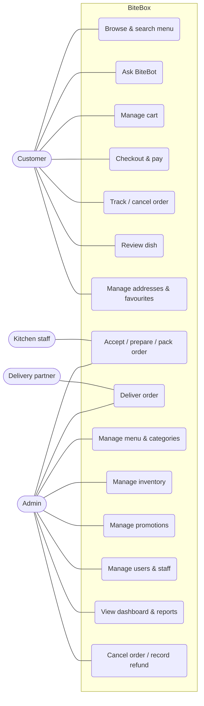
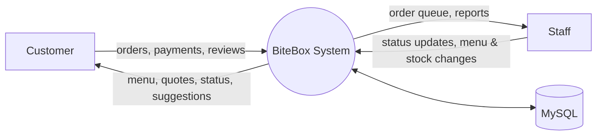
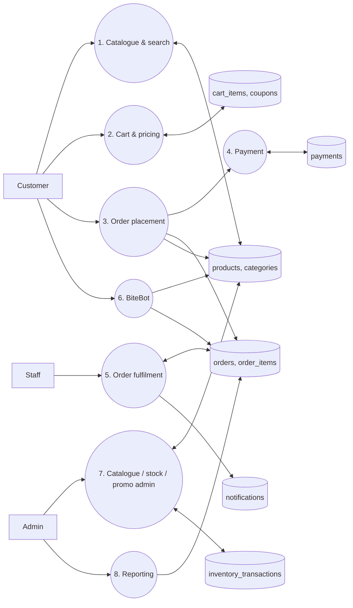

# BiteBox: college project report material

## Abstract
BiteBox is a web-based food ordering and restaurant management system for a single restaurant. Customers browse a categorised menu, place delivery or pickup orders with cash or (simulated) online payment, track orders in real time, and get food suggestions from an AI assistant called BiteBot. Restaurant staff use a role-based dashboard to run the kitchen queue, manage the menu, inventory and promotions, and view sales analytics.

The system is built with Angular 22, ASP.NET Core 9 and MySQL 8, following Clean Architecture. It enforces critical business rules on the server: price recalculation, stock reservation without overselling, idempotent checkout, and a strict order state machine.

## Problem statement
Small restaurants often take orders by phone or messaging apps, or through third-party aggregators that charge high commissions. Manual ordering causes wrong orders, no stock visibility, lost sales records and no customer history. Generic templates lack inventory control, role-based staff workflows and data integrity under concurrent orders.

## Objectives
1. Let customers order online easily: search, filters, cart, checkout and tracking.
2. Give each staff role (kitchen, delivery, admin) exactly the tools and permissions it needs.
3. Guarantee data integrity: server-side pricing, no overselling, no duplicate orders, auditable history.
4. Provide management insight: revenue, top dishes, order status and low stock.
5. Add AI recommendations that are *useful and safe*, meaning grounded in the real menu.
6. Follow professional engineering practice: layered architecture, tests, documentation and containerisation.

## Scope
**In scope:** a single restaurant; customer accounts; menu, cart and checkout; COD and simulated online payment; coupons; order lifecycle and tracking; in-app notifications; reviews; favourites; addresses; admin dashboard; catalogue, inventory, promotions and user management; CSV reports; BiteBot; Docker; CI.

**Out of scope (future):** multiple restaurants or branches, a real payment gateway, live GPS rider tracking, SMS/email/push notifications, a native mobile app, and loyalty points.

## Existing system vs proposed system

| Aspect | Existing (phone / aggregator) | BiteBox |
|---|---|---|
| Ordering | Phone calls, manual notes | 24×7 web ordering, cart and checkout |
| Pricing | Mental arithmetic, inconsistent | Server-calculated totals, GST, coupons |
| Stock | Unknown until the kitchen runs out | Live stock, atomic reservation, low-stock alerts |
| Status | Customer calls to ask | Live tracker and notifications |
| Staff roles | Everyone does everything | Kitchen, Delivery and Admin permissions enforced by the API |
| Records | Paper, scattered chats | MySQL history, dashboard, CSV reports |
| Commission | 18–30% to aggregators | Own channel |
| Recommendations | None | BiteBot (budget, diet, spice, past orders) |

## Use-case diagram

## Data flow diagram

**Level 0 (context)**

**Level 1**

The system architecture, ER diagram and state machine are in [ARCHITECTURE.md](ARCHITECTURE.md).

## Screenshots to capture for the report
1. Home page (hero, categories, bestsellers)
2. Menu with filters applied
3. Dish detail with reviews
4. BiteBot answering "veg dinner for two under ₹700", with its combo
5. Cart drawer and cart page
6. Checkout with a coupon applied
7. Simulated payment page
8. Order tracker mid-way (e.g. "Cooking")
9. Admin dashboard
10. Kitchen queue with the order detail panel
11. Menu item editor with image upload
12. Inventory with movement history
13. Swagger UI
14. Test run output (backend and frontend)

## Demonstration script (about 10 minutes)
1. **Customer (Priya):** search "paneer", filter veg, open Paneer Butter Masala, add 2. Ask BiteBot "spicy veg dinner for two under ₹700", then *Add combo*.
2. Checkout: switch to pickup and back to delivery, apply `BITE20`, pay online, and show the successful payment.
3. Show the order tracker at "Order placed". In a second browser, sign in as **kitchen@bitebox.dev**: the order is in the live queue. Click *Accept order*, *Start cooking*, *Mark packed*.
4. Sign in as **delivery@bitebox.dev**: only ready delivery orders are visible. Mark *Out for delivery*, then *Delivered*. Priya's tracker and notification bell update.
5. **Admin:** the dashboard shows the new revenue. Restock a low-stock dish and show the movement history. Create a coupon. Block a user.
6. **Security talking points:** show that a customer gets 403 on `/api/v1/admin/dashboard` in Swagger, and explain the CSRF token and server-side pricing.
7. Run the tests (`dotnet test`, `ng test`) and explain the overselling race test.

## Testing summary
See [TESTING.md](TESTING.md) for recorded results.

## Future enhancements
- Multiple branches or a marketplace (vendor entity, per-branch stock, settlements)
- Razorpay/Stripe test-mode adapter, then live payments after compliance review
- Real-time updates with SignalR instead of polling
- Email, SMS and WhatsApp notifications through more domain-event handlers
- Rider app with GPS tracking; delivery assignment and ETA
- Product variants and add-ons (sizes, extra cheese) and allergen data
- Loyalty points and referral codes
- BiteBot: conversation memory, Hinglish understanding, embedding-based similarity
- Observability (OpenTelemetry), Redis caching for the menu, CDN for images
